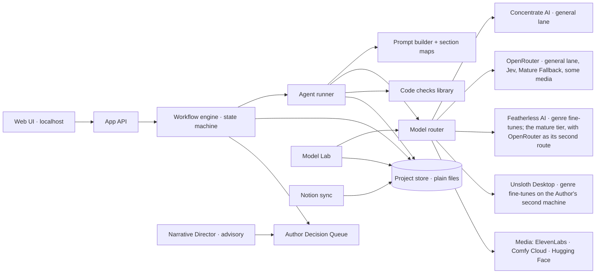

# Writing EOS · Requirements and Architecture

| | |
|---|---|
| **Version** | 0.30 · the mature tier is the uncensored models an inference provider or aggregator serves, fitted by pen name and subgenre (D33) |
| **Date** | 2026-10-21 |
| **Owner** | The Author |
| **Builder** | Claude Code, as the single build agent |
| **Status** | Requirements, architecture and decisions agreed. Phase 0 under way: harness phases 1 (runs) and 2 (automatic scoring) built 2026-10-17; audit bugs B1–B3 and B7–B9 fixed 2026-10-18 (harness: 73 tests); app engine started 2026-10-18 (`eos-app/`: Story Blueprint formula engine, from 2026-10-19 Humanize, from 2026-10-21 the workflow engine and the shared library, with the Author's eight pools imported; from 2026-10-22 the model registry and router; from 2026-11-12 the corrections of the November audit, the database sync and the readiness report; 260 tests). **The app does not run yet:** nothing sends a prompt to a model or shows a screen; the first real run is Group D of `FIXES_IMPLEMENTATION_PLAN_2026-11-11.md` |

**Sources this document is built from**
1. The design canvas *Writing EOS App* (9 screens): https://claude.ai/artifact/HL7wfJWnqk7QcLaBFjdUGZ
2. Notion · *Narrative Writing EOS*, especially the **Story Blueprint Pipeline** (Stages 0–3), **Character Development — Canonical Pipeline & Creation Mode** (2026-10-16), **World Naming System — Global Framework**, the **♻️ Creative Reserve** database, **Canon and Continuity Verification**, **Character State Delta Analyst**, **Narrative Director**, and **Test Run 01**.
3. The Character Development vault on F: (charter v2.0, hand-off contracts v2.0, plans v3.0, 2026-10-17).
4. The bake-off harness specification: `eos-bakeoff/eos-bakeoff/CLAUDE.md`, `docs/SPEC.md`, `config/*.yaml`, `prompts/*.md`.
5. *Mapping the Stages of Conflict & Character Arc* and *Game Theory & Narrative Construction* (arc model; secrets, knowledge and relationships).
6. Four commercial writing apps whose best features Writing EOS borrows (§1.4): LivingWriter (livingwriter.com), RaptorWrite (raptorwrite.com), Sudowrite (sudowrite.com) and Novelcrafter (novelcrafter.com), reviewed 2026-10-18.
7. Story Hacker OS, an AI writing app for authors, from its 1.0 launch walkthrough (*I Quit Every AI Writing Tool… So I Built My Own*, The Nerdy Novelist, 2026-07-01) and its public description, reviewed 2026-10-18: genre templates built from bestseller analysis, writing automations, pipeline controls and model choice, and system history.
8. An independent audit report (2026-10-18) comparing v0.3 with four other studio plans it names Scriptorium v1–v2 and Storyloom v1–v2. This document relies on the audit's account of those plans; the plans themselves were not available. Its nine bug findings were checked against the code: all nine were real, and B2 could not happen at run time because the prompt builder already refuses Section D for models that are not mature_ok.
9. The open-source repository *gracie007-cloud/ai-humanizer-app* (GitHub, commit ace01f0, reviewed 2026-10-19): an AI-text humanizer with strength levels, multiple passes, an English-variant rule, plain-text clean-up, rhythm and vocabulary measures and settings suggested from the text. It has no licence file, so Writing EOS uses its approach only: none of its code or prompt text is copied. Its stated aim, passing AI detectors, is not adopted (D16).

**Changes in v0.30 (2026-11-25), decision D33:** the **mature tier** is rebuilt from three sources: the Notion roster *LLM Identifier*, the Notion catalog *LLM Identifier for Creative Writing: Abliterated & Uncensored Models* (91 rows, `llm-identifier-creative-writing-abliterated/abliterated_models.csv`), and the model register `registry.json` with its routing table `routing.json` (verified against Featherless AI and Hugging Face on 2026-11-14). The Author's rules (2026-11-25): the mature tier is the uncensored or abliterated models that an **inference provider or an aggregator** serves (Featherless AI, OpenRouter); Hugging Face GGUFs are **bases for later fine-tuning** and are never called; local models (Unsloth Desktop) are not in the tier, since local work is not planned for now. What changes: (1) every catalog model is uncensored on every route the sources give it; (2) prose writers are chosen by the book's **pen name and subgenre** from the register's routing table (lead writers, then strong adjacent fits), then by the subgenre tags of the catalog and the register, replacing the roster's single Genre column, which was never filled; (3) a text component with no mature expert hands a mature passage to the mature tier for the book instead of stopping; (4) two routes to one set of weights count as one model for P8 and for outages (Venice Uncensored on OpenRouter is Dolphin Mistral 24B Venice Edition on Featherless AI; UnslopNemo 12B v4.1 likewise); (5) each model carries the context its provider actually serves; (6) the routing table names pen names, so it stays outside the app and is read where it is (D10). The tier holds 62 models on 64 routes. P10, FR-ML-1, FR-LIB-13 and §6.4 updated; the readiness report sizes the tier.

**Changes in v0.29 (2026-11-12), decision D32:** the Author retired the four **quality tiers** (Basic, Excellent, Premium, Advanced). Each component's line of experts already orders its models, with the cheaper comparable one first (D27, D29), so a second way of choosing writers added nothing. Removed: the glossary entry, FR-ML-5, the tier in FR-PRJ-2, FR-GEN-1, FR-RC-5, FR-PP-1 and NFR-5, and the tier in the router (§6.4). What the Advanced tier did for untested work is kept without the tier: an edited prompt, changed settings or a model with no round behind it may still run, and its output is **marked experimental** until a Model Lab round scores it (FR-PP-4). Choosing a model by hand stays what it was otherwise: Try Fallback, which moves to the next expert in the line. The words *tier* that remain mean other things and are unchanged: the Swarm Tier, the mature tier, character Tiers 1–3 and a book's content tier.

**Changes in v0.28 (2026-11-12), consolidation pass (fixes plan C1):** no new decision. Every place that still described routing as it stood before D27–D30 now says what those decisions say: P7 and P10; the glossary entries *Task type* and *Slots*; FR-CD-7, FR-CH-3, FR-ML-4, FR-ML-6, FR-WS-2 and the Workshop Chat row, FR-AU-5, FR-AU-6, FR-FN-5, FR-SW-1, FR-SW-3, NFR-1; the architecture diagram (§6.1), the model router (§6.4, rewritten) and the agent definition example (§6.7); Appendix A (now the 123 components by phase, generated from `config/components.yaml`) and Appendix B (now clearly the bake-off harness's candidate pools). The decision table (§9) is history and is left as written. The quality tiers were retired next, in v0.29.

**Changes in v0.27 (2026-11-12), corrections from the audit (`FIXES_IMPLEMENTATION_PLAN_2026-11-11.md`):** no new decision; the code now does what D18, D22 and D27 already say. (1) **Gates are enforced by the queue** (FR-FLOW-3): nothing after an Author gate in the Flow Order is offered until that gate is approved; the recipe gate applies only when a recipe was built. Chapters keep their own progress, planning may run ahead, and drafting waits for the previous chapter's lock (FR-GEN-5, FR-FLOW-4). (2) **Routes** (D22): a model listed in the roster under two providers has two routes, and on an outage the router tries the same model's other route before the next expert. P8 compares models by roster name, so a checker never judges its own model through another provider. (3) **A model with no provider model ID is never chosen.** (4) **The prose lane keeps its safety net:** a tagged genre fine-tune leads, and the component's own experts stay behind it (mature prose unchanged, P10). (5) **Lane provider lists are enforced**, and a media component takes only models that make what it makes. (6) **Expert slots are named for their place in the line:** `primary`, `comparable`, `fallback` in `components.yaml` (the Notion columns keep their names). (7) **The app follows the database by a command in the repository** (FR-NM-1): `python -m eos_app.sync` builds `components.yaml` from a Notion export joined with `config/component_inputs.yaml`, the app-owned table of inputs, code parts, judged components and media kinds (Q13 stands: an Inputs column in Notion is still the Author's call). (8) **Readiness report:** `python -m eos_app.readiness` says which components could run today, what an outage of each provider would stop, and what is open. The consolidation pass followed in v0.28.

**Changes in v0.26 (2026-10-22), decision D31 extended:** a scaffolding pool is **under development**. Research completes it, and the Author marks it complete by moving its file out of the *Brainstorming Scaffolding Documents* folder; only then does the app change its `source_folder` and drop `standing: scaffolding`. All five character reference pools stay under development (the Author doubts even Character Flaws is complete). Each pool's reader is now the one component whose Notion page shows it doing that job: Traits and Strengths and Animal Traits → Personality Type (trait inference; its Temperament framework), Flaws → Character Polish, Clothing → Character Voice Guide (the Style Bible's Fashion Designer layer). No page names epithets, so the epithet words have no reader until the Author assigns one.

**Changes in v0.25 (2026-10-22), decision D31:** five reference pools from the Author's *Fictional Character Development* knowledge base join the library (FR-LIB-17): Character Traits and Personal Strengths, Character Flaws, Animal Traits (a four-temperament personality model), Character Building epithet words, and Types of Clothing. The library now reads spreadsheets (.xlsx) and Word documents (.docx) with the standard library (`eos_app/office.py`), copied byte for byte like the notes. **Everything the Author uploaded to the vault on 2026-10-22 is scaffolding:** brainstorming material with incomplete information (the implementation plans in *Writing EOS Agents Implementation Plans_v2*, the *Fictional Character Development* knowledge base, *Mapping the Stages of Conflict & Character Arc* and *Game Theory & Narrative Construction*). It is never the source of truth: the Narrative Components database, the team specs and these requirements govern. The Character Pool is the refined version of the knowledge base's character list.

**Changes in v0.24 (2026-10-22), decision D30:** **hosting.** The app runs on the Author's own computer at no hosting cost; the Author reaches it from other devices over **Tailscale**, a private network, so nothing is opened to the internet. No cloud hosting: Google Cloud is ruled out by the Author for cost, and AWS, Azure and pay-per-request platforms bill the same way. **Unsloth Desktop runs on a second machine** on the same Tailscale network; the app reaches it at an address set in `.env`, not on `127.0.0.1`. The app needs no GPU (8 GB RAM, 16 comfortable); only the Unsloth machine needs one.

**Changes in v0.23 (2026-10-22), decision D29:** the Author's model rules. **Cheaper first:** when two models are comparable, the less expensive is the Primary, and the same rule picks the Fallback. The Narrative Components database gains a **Fallback Model** column, read by the router after the Primary and Comparable. The **9 checkers** that shared a Primary with what they judge (Conflict Scoring, Archetype Check, Representation Check, World Check, Logic, Emotion and Reference Checks, Canon Check, Timeline Check), and Edit Coach, now lead with their former Comparable, with a Fallback from the Author's own frontier/open pairs (DeepSeek V4 Pro, Qwen 3.8 Max, Kimi K3). **Media** Comparables and Fallbacks run on **Comfy Cloud**: open-weight image (Qwen-Image, Z-Image Turbo), video (Wan 2.2, LTX-2), speech (VibeVoice, Chatterbox), music (MiniMax Music 3, ACE-Step) and sound (MMAudio, Stable Audio Open). **Mature media** goes only to open models on Comfy Cloud: its terms ban only illegal content, while fal.ai bans sexually explicit content and OpenRouter defers to models that refuse it. The 13 workspace components still being built by the Author stay out until their team specs and implementation plans are ready.

**Changes in v0.22 (2026-10-22), decision D28:** two areas the app had missed, approved by the Author. **Self-editing and proofreading** (FR-SE): Proofreader (Grammarly-style correctness and house-style consistency), Self-Edit Reports (ProWritingAid- and AutoCrit-style reports, by code) and Edit Coach (explains an issue and proposes a fix). **Generative media** (FR-MD): Visual References, Map Maker, Interior Art, Cover Art, Marketing Visuals, Audiobook Narration, Music, Sound Effects, Trailer Video and Trailer Assembly, with two checkers, Visual Consistency Check and Narration Check. Fifteen components in all (Music and Sound Effects split under D25); the Narrative Components database now has 123 rows, Flow Order 1 to 122. Media moves into version 1 (§1.3). The roster gains a Modality column and three providers, ElevenLabs, Comfy Cloud and Google AI (§6.9). Narrating a mature book is open.

**Changes in v0.21 (2026-10-22), decision D27:** the app now has its model registry, `config/models.yaml`, built from an export of the Author's roster *LLM Identifier* (FR-ML-1), and its router, `eos_app/router.py` (§6.4). Each component has a **line of experts**, a Mixture of Experts and not model families: its Primary (the database's Frontier Model), its Comparable (Comparable Open-Weight) and the roster's Fallback Model. Building Blocks, Sales & Marketing and the evaluation components run on those experts through Concentrate AI or OpenRouter; the Prose Writing components that write use models fine-tuned for the book's genre, through Featherless AI or Unsloth Desktop, tagged in the roster's Genre column. **P8 is restated**: a checker never runs on the same model that wrote what it judges; the router steps to the checker's next expert. Each of the 18 evaluation components records what it judges and has a **Mature Fallback** (Venice Uncensored) for mature text its experts refuse. Target Audience Selector moved to just after the pen name (flow 9) so the intake reads its Reader Contract; Fiction Tropes Generator runs on Claude Fable 5.1 and Target Audience on GLM 5.3 Flash.

**Changes in v0.20 (2026-10-22), decision D26:** the Story Bible is now the twelve elements of a story bible (title and logline, synopsis, characters, setting and world-building, plot and structure, themes and symbolism, dialogue and voice, visual references, timeline, research and references, glossary, appendices), each filled by the components whose job it is; the earlier registers live inside them (§4.4, FR-SB-3, `config/story_bible.yaml`). **Worldbuilding is an element of the Bible**, done by one of three approaches the Author keeps in the themes workbook (Components, G.R.A.P.E.S., M.E.R.P.S.): Worldbuilding proposes one from the book's genre, plot and Canon theme, the Author approves it (FR-DEV-24). Eight more sheets of that workbook join the themes pool, all the sheets now kept in the vault folder *Theme in Literature* (FR-LIB-16); the importer now reads a named file wherever it is (FR-LIB-2). Each theme's structure fit is shown beside the Structure Fit scores, never added (FR-DEV-20).

**Changes in v0.19 (2026-10-22), decision D25:** the Author pointed out that the worked example had been done by one model in one pass, the very thing the component design exists to prevent. Traced component by component, it showed four gaps in the design, now closed. (1) **Worldbuilding and Locations read the Character Pool's setting cards** (12 places, among them a planet, a habitable meteor and a moon resort around the station); settings are places, never cast (FR-LIB-4, FR-DEV-24). (2) **World Check checks the developed cast against the world**, so a backstory that doesn't belong in the setting goes back to Character Development to retune (FR-DEV-24). (3) **Return channel R6:** a role a character needs that only appears during development (in Character Profile or the Mirror Map) goes back to Cast Roles and Character Pool Match (FR-CD-5). (4) **The Story Bible finishes the characters:** Cast and Structure drafts the Character Arc and Theme entry on the structure's beats, and the Story Bible Builder finishes it at the Story Bible lock (FR-LIB-15).

**Changes in v0.18 (2026-10-22), D24 extended:** the Author's review of the worked example found two more lapses. A pool character kept her river-crossing origin in a space opera: adaptation must regenerate the Skin for the book's world, so a Skin field left word for word as on the card now blocks G5 unless the Author keeps it (FR-CD-10). And her arc named a deputy who was never cast, with 455 characters in the pool: an arc entry's relationships must now name cast characters, so an uncast role goes to Character Pool Match first (FR-LIB-15).

**Changes in v0.17 (2026-10-22), decisions D23 and D24:** a worked example (a pool character taken through to her Character Arc and Theme entry) showed four gaps in the flow, now fixed. (1) **Structure (Q10, D23):** the Author's Conflict and Structure Map is the standing order; Structure Fit scores its 21 structures, the Conflict Core first, then the formula, with Inevitability and Novelty taken from the map (FR-DEV-3, FR-DEV-20, Appendix C7). (2) **A pool card is a launchpad (D24):** Character Development completes a matched character in a new adaptation mode, and gate G5 waits for a complete profile; what the Author marked settled-open is never filled (FR-CD-2, FR-CD-10). (3) **The arc entry follows the structure:** Cast and Structure writes it, approved with the cast map and structure, so the arc is laid on the chosen structure's beats (FR-LIB-15). (4) **Themes are Canon or Motif:** the Author's themes list gains a Theme Type; Story Pitch proposes the book's Canon theme, confirmed with the Conflict Core; a lead character's arc carries a Canon theme (FR-LIB-16).

**Changes in v0.16 (2026-10-21):** two more of the Author's spreadsheets join the themes pool, matched by theme name: *Themes in Literature List* (a definition for each of the 167 themes) and *Complementary Theme* (a partner theme for each, with how the two intersect). Suggestions show each theme's definition and its partner with the partner's own fit for the book (about one good-fit theme in ten has a partner that is not an ideal fit). Models receive the chosen themes' definitions and pairings, never the genre-fit lists. The import report says if the three spreadsheets stop lining up.

**Changes in v0.15 (2026-10-21):** the Author's *Themes in Literature* spreadsheet (167 themes, each with the genres it is a good, situational or not an ideal fit for) becomes the library's eighth pool (FR-LIB-16), answering Q12: all 167 are one list for now, without the template's Tier 1 and Tier 2. Arc entries take their theme from it, and theme suggestions follow the book's genre path, the most specific listing deciding. The import report lists five genre terms that name no genre in the pools and notes that the list has no drama terms.

**Changes in v0.14 (2026-10-21), decision D22:** the Author's sample routing architecture (a router layer, Concentrate AI as the primary route, Featherless AI as the open-weight route, and a lane of abliterated community models) is adopted with four adjustments. (1) The router is the app's own code, not a hosted gateway such as Portkey: a gateway would be another outside service seeing every prompt, and it cannot apply the rules that make routing correct (mature content to mature_ok models only, a checker from another family, no answer keys). (2) Fallbacks stay per component, each on a different provider from its Primary where possible, so an outage lands every component on a model tested for that job. (3) Abliterated models are mature-lane only, must pass the mature brief, and count as their base model's family. (4) All four providers stay: OpenRouter carries Jev and some Fallbacks, and Hugging Face is the second mature endpoint. §6.1, §6.4, §6.9, P8, FR-ML-1 and FR-ML-4 updated.

**Changes in v0.13 (2026-10-21), D20 extended and D21:** the four further folders in the Author's vault join the library (§4.20, FR-LIB-11 to 15). The **Story Pitch Pool** (37 writing topics) feeds Brainstorm, Idea Intake and Story Pitch; its doctrine topics feed the Story Bible instead. **Content Levels** (spice, violence and swearing, 0 to 5, for 532 subgenre paths) set each book's ceiling and decide which scenes go to the mature tier (D21). The **Conflict and Structure Map** (9 conflict cores and 27 modifier values against 21 plot structures) gives Cast and Structure a shortlist beside the formula's six scored structures, and the app lists where the map and the formula's structure table disagree (7 points) for the Author to settle. **Character Arc and Theme** is written by the app, one entry per character, after the Author approves arc and outcome. Open questions Q9 to Q12 (§9.2) need the Author.

**Changes in v0.12 (2026-10-21), D20 revised:** the shared library is rebuilt to the pools as the Author built them, read from the vault on this computer (`OneDrive\Documents\Obsidian Vault\Writing EOS`). The third pool is the **Narrative Genres Pool** (`library/narrative-genres/`). The app now uses the vault's own field names and its **Controlled Vocabulary** for status and role; a character card's `**field:**` lines count as fields; a pen name is built from the subgenre rows that name it; and models get a style's description, never the authors, directors or works it names. New characters land in `library/characters/new/` for the Author to copy into the vault, which stays the master. First import: 455 characters, 32 pen names (609 subgenre rows) and 569 genres; the problems found are in `docs/LIBRARY_IMPORT_REPORT_2026-10-21.md`.

**Changes in v0.11 (2026-10-21), decision D20:** the Author's three pools, built in an Obsidian vault for the components to draw on, become the app's **shared library** (§4.20): one copy beside the projects, not inside each project, because characters, pen names and genres are reused from book to book. The library stays Obsidian Markdown; a field map translates the vault's own field names, so no note is rewritten. Code enforces pool before creation (P4), writes a character into the pool only at gate G5, and never offers an incomplete, retired or reserved entry. Built and tested as `eos-app/eos_app/library.py` with `config/library_map.yaml`.

**Changes in v0.10 (2026-10-21), decisions D18 and D19:** the app follows the Notion database *Narrative Components*, not the other way round. `eos-app/config/components.yaml` is the app's copy of it: every component's Step, database name, a **plain name** for the Writer view, Flow Order, phase, how it runs, its inputs, its gate, its code parts, its **Swarm Tier** and its **Jev role** (§4.19). The workflow engine (`eos_app/workflow.py`) reads it, decides what runs next and refuses an order that breaks an input. Characters now wait for the naming system in the formula engine's stage gates. Models will be routed through four providers: Concentrate AI, OpenRouter, Featherless AI and Hugging Face (D19, §6.4).

**Changes in v0.9 (2026-10-21), decision D17:** the Author's Notion database *Narrative Components* (106 components) is now the order of work. An independent audit and a dependency check found 16 places where a component ran before an input it needs; all are fixed in the database's Flow Order, with each component's phase, how it runs (in sequence, per chapter, only on a failed check, on demand, cross-cutting) and the Author gate after it (FR-FLOW). The World Naming System is built before any character is named (§4.2 step 3). §4.18 specifies the fifteen components the database adds: canon maintenance and the style sheet, the reader specification, a fact base from the Author's own sources, the planned master timeline, sensitivity reading, beta readers, line and copy edits, typesetting, proofs, and the release and derivative work. D13 stands: no web retrieval.

**Changes in v0.8 (2026-10-19), decision D16:** §4.17 *Humanize* specifies the Editor's Humanize action (FR-ED-1) and its use as a Prose Refinement pass: code protects dialogue and locked lines behind placeholders, builds the request from strength, passes, English variant, em dash policy and the project style card, cleans the output, measures rhythm, vocabulary and stock phrasing before and after, checks length and Story Bible names, and retries a failed call before the Fallback. Settings are recommended by code from the text. The model is the Edit Actions model (Primary, Fallback, mature tier); the result is a suggestion through the paragraph gate. Built and tested as `eos-app/eos_app/humanize.py` with `config/humanize.yaml`. The canvas Editor shows it in the Rewrite tool, with numbers computed by the engine.

**Changes in v0.7 (2026-10-18), decision D15:** the Notion *Story Blueprint Pipeline* (Stages 0–3, the Conflict Taxonomy, Axis 7 Pillars, GANT 2.0) is now specified in full. Its formula and decision tables are in **Appendix C**, held as configuration. Every step that can be computed moved to code (FR-DEV-14 to FR-DEV-23): the Pillar factor, Conflict Fit totals and decision table, the antagonist rule, the GANT conversion, the Climax Outcome Matrix, the categorical Structure Fit factors, the Cast Function Map and the stage gates. Agents may now settle the routing those formulas determine (FR-AU-3). The Conflict Core pick, the outcome and the structure stay the Author's final calls (FR-AU-4). The engine is built as tested Python in `eos-app/`.

**Changes in v0.6 (2026-10-18), decision D14:** every narrative component in the Notion registry *AI Agentic LLM* (v2) is now in the app. Five new agents (Narrative Builder, Plot Blueprint Writer, Synopsis Writer, Style Calibrator, Dossier Keeper); the Originality & Trope Critique joins the QA gate; the Story Dossier becomes a named workspace (FR-DEV-9 to FR-DEV-13); Appendix A goes from 49 to 55 model-routed Story Blueprint agents. The Notion registry gains rows for app agents that had none, with starting model assignments.

**Changes in v0.5 (2026-10-18), decision D12:** §4.16 *Production hardening* with the audit findings that fit the blueprint: context budget (FR-CTX), craft and voice measures (FR-VC), editor safety (FR-ED-6 to FR-ED-9), run branches and loop convergence (FR-RC-8, FR-CH-8), story time (FR-CH-9), canon upkeep while writing (FR-SB-10, FR-WS-6), structure flags (FR-GP-8, FR-MX-6), words kept (FR-ML-12), archive, export, import and an AI involvement report (FR-EX); principle P16; P15 amended; NFR-15 and NFR-16; §6, §7 and §8 updated. §9.1 recorded eight questions for the Author; **the Author chose the recommended option for all eight (D13)**: a quiet pace line on Home (FR-HM-6), a vendored rich-text editor for the Editor and Score drafts only, a rebuildable SQLite cache without semantic search, no hand-picked models beyond today's rule, a Story board that edits the outline (FR-MX-7), Markdown and DOCX import first, no web research step, and words kept as a tie-breaker. The canvas shows the v0.5 items (§7), with two new screens: Story board and Export.

**Changes in v0.4 (2026-10-18), decision D11:** §4.15 with **genre packs** (FR-GP), **recipes and run controls** (FR-RC) and **project history** (FR-HI); two new model-routed agents (Genre Analyst, Recipe Builder); §1.4 adds Story Hacker OS; glossary terms; FR-PRJ-2, FR-PRJ-5, FR-DEV-1, FR-DEV-3, FR-GEN-1, FR-GEN-3, FR-HM-1, FR-AU-4 amended; §6.2, §6.3, §6.6, §7, §8 and §9 updated. The canvas gains the Genre packs, Recipes and History screens.

**Also in v0.3 (2026-10-18), after the UI review:** NFR-11 and NFR-12 (design system; Writer and Engine views).

**Also in v0.3 (2026-10-18), commercial naming:** NFR-14; FR-SB-1 shows versions by status and date; FR-RV-1 numbers drafts for the Author; test rounds have plain names and dates, with codes in the Engine view only.

**Also in v0.3 (2026-10-18), Author as final decider (D10):** agents pitch every Author decision (recommendation, options weighed, reasons, consequences) and the Author proceeds, picks another option, or gives their own alternative (P1, FR-HM-5, FR-AU-4). Examples throughout are now generic; the app carries no reference to a particular novel (NFR-13).

**Also in v0.3 (2026-10-18), autonomy:** per-section autonomy levels (§4.14, decision D9): P1 and §6.1 amended, the *Decided for you* digest on Home, decision scoring in the Model Lab, the Autonomy screen.

**Changes in v0.3 (2026-10-18):** §1.4 *Product lineage*; principle P15; glossary terms; §4.13 with six borrowed features (Mentions, Progressions, Prompt preview, Workshop chat, Matrix, Brainstorm keepers) and five new model-routed agents; matching updates to FR-SB-3, FR-ED-1, FR-HM-2, §6, §7 and §8.

Where these sources disagree, this document follows the newest canonical source and records the choice in §9 *Open decisions*.

---

## 1. Purpose and scope

### 1.1 What Writing EOS is
An internal, single-author application that develops and writes novels as **a team of agents, each running on the model that tested best for its job**. No single model writes the book. The Author is the **final decider, never the primary producer**: at every decision point the agents prepare a pitch, and the Author proceeds with it, picks another option, or gives their own alternative. The agents propose, check and draft.

### 1.2 In scope for version 1
- Projects with a governing pen name, genre, literary style and world.
- **Develop**: the Story Blueprint, from braindump to locked outline, including character sourcing and creation.
- **Story Bible**: versioned canon with arcs, Pillars, secrets, who-knows-what, relationships, naming, style rules and the Creative Reserve.
- **Chapters**: the chapter pipeline, batch generation, the Editor and blind review.
- **Model Lab**: bake-off rounds, the evidence for each component's experts, calibration.
- **Blueprint** view: how the system is wired, for the Author.
- Notion sync for the model registry, bake-off results and the Creative Reserve.
- **Borrowed writing tools** (§1.4, §4.13): mention tracking, progressions, prompt preview, Workshop chat with Extract, the Matrix and Brainstorm keepers, each routed through the blueprint.

### 1.3 Out of scope for version 1
- Multiple users, accounts, sharing or hosting for others.
- Book assembly and export beyond Markdown and DOCX of locked chapters (Book Constructor is phase 7).
- Narrating a mature book (open, D28): speech providers refuse explicit text. Other media is in scope (D28).
- Training or fine-tuning models.

### 1.4 Product lineage · what is borrowed and how it changes
Writing EOS borrows the best features of five commercial apps. None of them routes work by evidence: Sudowrite uses one house model (Muse), and LivingWriter, RaptorWrite, Novelcrafter and Story Hacker OS let the writer pick a model by hand. In Writing EOS every borrowed feature is either **code** (P9) or an **agent with a task type**, so the router fills it with the model that tested best, and the Author still decides at gates (P1).

| Borrowed feature | From | How it changes in Writing EOS | Where |
|---|---|---|---|
| **Mentions** · aliases, automatic tracking, "Appears in", mention timeline | Novelcrafter Codex; LivingWriter Elements | Built by code. Also chooses what context an agent receives (P15), and flags names that match no Bible entry | FR-MN · Bible, Editor |
| **Progressions** · entries that change over the story | Novelcrafter | Every field can change from a chapter or beat; agents only ever see the Bible *as of* their chapter (P14). State Delta proposes progressions; the Author accepts them | FR-PG · Bible |
| **Prompt preview and components** · see the exact prompt; build prompts from reusable parts; per-model settings | Novelcrafter; RaptorWrite | Every part is labelled with its source and why it was included. An edited prompt is a new, untested version: its output is marked experimental until the Model Lab re-tests it | FR-PP · Chapters, Editor, Model Lab |
| **Workshop chat with Extract** · chat with the scene and the story; pull beats or entries out of a chat | Novelcrafter Workshop; Sudowrite Chat; LivingWriter AI Chat | Each message is routed by intent (brainstorm, canon question, character interview). Chat never edits canon: Extract turns it into proposals that go through gates | FR-WS · every screen |
| **Matrix** · characters, places and threads across chapters; plot threads | Novelcrafter Matrix; LivingWriter boards and plot threads | Built by code from mentions, the outline, knowledge and relationships; flags gaps and unpaid setups. Read-only: plans change through the outline (P6) | FR-MX · Bible |
| **Brainstorm keepers** · thumbs up and down, "more like this" | Sudowrite Brainstorm | Searches the Creative Reserve first (P4); keepers and declines both go to the Reserve (P5); cards come from two models, blind, so your thumbs become Model Lab evidence | FR-BK · Editor, gates |
| **Genre packs** · genre templates built from analysis of bestselling books | Story Hacker OS genre templates | A pack is plain data the Author approves: reader promises, tropes with their freshness risk, structure beats scaled to the chapter count, pacing and length norms, voice cues and genre clichés. It feeds the existing scores and checks (Conflict Fit, Trope Audit, Structure Fit, Outline Audit, Style, Tone and Arc Check, auto-fail lists) instead of adding a parallel pipeline. The Genre Analyst builds a pack from the Author's notes on comparable books and keeps observations, never text from those books | FR-GP · Genre packs, Story Blueprint, Chapters |
| **Recipes and run controls** · writing automations; pipeline controls and model choice | Story Hacker OS automations and pipeline controls | A recipe is a saved chain of existing steps that runs through the same workflow engine, so every gate and always-yours decision still stops for a pitch (P1). It can make a section stricter for its run, never looser. Run controls: estimate, Pause, Resume, Stop, Skip an optional step, Re-run from a step, change tier, Try Fallback. Models still come from the router (P7) | FR-RC · Recipes, Generate |
| **Project history** · system history | Story Hacker OS history; Novelcrafter versions | One timeline of every version, run, pitch and answer, settled decision, recipe run and setting change, built by code from the project's git repository and logs. Compare any two versions; Restore makes a new version and marks later work stale (P6); named restore points before big changes | FR-HI · History, every screen |

**Already in Writing EOS before v0.3:** Write, Rewrite, Describe, Expand and Brainstorm on a selection (Sudowrite); a Story Bible built step by step from idea to outline (Sudowrite); structure templates (LivingWriter outlines, here scored by Structure Fit); scene summaries and version history (Novelcrafter); bring-your-own key and many providers through OpenRouter, with thinking budgets (RaptorWrite, Novelcrafter).

**Not borrowed:** one house model for everything (against P7); choosing the model by hand as the normal way of working (kept only as Try Fallback); one-click whole-book drafting without gates (against P1), including automations that skip the Author's decisions; another product's proprietary plotting frameworks or template text (packs and recipes are written for Writing EOS, or built by the Author); cloud sync, sharing and collaboration (§1.3); covers and image generation (Notion *Media Bible*, out of scope); word-count goals, sprint timers and streaks (a quiet pace line on Home instead, FR-HM-6).


**Adopted after the independent audit (v0.5, D12):** a token budget with the least important context left out first; deterministic craft measures and a measured voice profile with drift tracking; line locks, a paragraph-by-paragraph gate for multi-paragraph changes, an AI-free writing mode and span-level provenance; batch and recipe runs on their own branches; review loops that stop when they stop improving; story day and travel-time checks; canon proposals on every Editor save; beat word targets and unassigned-scene flags; *words kept* as Model Lab evidence; a one-file project archive, EPUB export, import and an AI involvement report. Each is code or a routed agent, like everything above.

---

## 2. Governing principles
These are requirements, not preferences. Every module must honour them.

| # | Principle | Source | Enforced by |
|---|---|---|---|
| P1 | **The Author is the final decider.** Agents do the work and **pitch** every decision assigned to the Author: a recommendation, the options they weighed, why, and what happens next. The Author proceeds, picks another option, or gives their own alternative, which the agents work in and check again. This holds at every autonomy level: delegable decisions (§4.14) are pitched-and-settled only where the Author allowed it, stay reversible, and the Author's final calls (FR-AU-4) are always pitched, never settled by an agent. | Notion, all pipelines; Author decisions D9, D10 | Author Decision Queue (§4.10); pitch format (FR-HM-5); autonomy policy (§4.14) |
| P2 | **The pen name governs; the braindump adapts.** The story is reshaped to the pen name, never the reverse. | Story Blueprint, Governing Rule 1 | Premise Adaptation step; routing of style checks |
| P3 | **Braindump characters are placeholders.** Only their role survives. | Governing Rule 2 | Role Extraction |
| P4 | **Source first, build second.** Every role is matched against the Character Pool before a character is created. | Governing Rule 3 | Character Selector |
| P5 | **No creativity wasted.** Every unchosen name, concept, option or seed goes to the Creative Reserve with origin and critique. | Governing Rule 4 | Gate handler (§6.6) |
| P6 | **Revisions travel upstream.** A later stage never patches earlier work; it sends the work back, and everything after it re-runs. | Story Blueprint rule 6 | Stale propagation (§6.6) |
| P7 | **Best-fit model per component.** The *Narrative Components* database assigns each component its line of experts (Primary, Comparable, Fallback; D18, D27); the model registry holds the facts about each model. Model names written anywhere else are suggestions. | Canonical CD page; D18, D27 | Router (§6.4) |
| P8 | **A checker never judges its own model's work.** An evaluation component never runs on the same model that wrote the text it judges; independence comes from the Author's line of experts per component (Primary, Comparable, Fallback: a Mixture of Experts), not from grouping models into families (D27). Each evaluation component lists the components it judges. | Harness rule 7; CD charter §6; D27 | Router |
| P9 | **Counting is code.** Scores with formulas, schema checks, verbatim citations, word counts, collision checks, knowledge tables and reveal order are computed by code, not by a model. | Design blueprint | Code checks library (§6.5) |
| P10 | **Mature content stays in the mature tier.** A model is `mature_ok` when it is uncensored (its roster Uncensored box, or a row in the Abliterated & Uncensored Models catalog), it is served by an inference provider or an aggregator (Featherless AI, OpenRouter), and it is not a fine-tune base (D33). Mature text is written only by a mature_ok model fitted to the book's pen name and subgenre, and a refusal moves to another mature_ok model, never to a general one. Mature media is made only by an open-weight model on a provider whose terms allow it (Comfy Cloud; Featherless AI for narration). An evaluation component tries its own experts first and, for mature work they refuse, its Mature Fallback (D27, D29). | Harness rule 6; D27, D29 | Router guard |
| P11 | **Canon status on every field.** `CANON` · `PROVISIONAL` · `UNKNOWN` · `OPTION` · `AUTHOR DECISION REQUIRED`. Agents cite only CANON; only the Author promotes. | CD charter §8; Creation Mode Clause | Store schema |
| P12 | **Fail loudly, keep everything.** Failed calls are recorded, retried at most twice, never dropped; outputs are saved verbatim; nothing is deleted. | Harness rule 8 | Run log |
| P13 | **Secrets and keys stay in `.env`.** Never printed, logged or committed. | Harness rule 3 | Config loader |
| P14 | **Characters act on what they know.** Every check reads who-knows-what as of the chapter, not the full truth; more broadly, every agent reads the whole Bible *as of* its chapter (progressions, FR-PG). | Game theory notes; Canon & Continuity page; Novelcrafter progressions | Knowledge table (§4.4); as-of resolver (§6.5) |
| P15 | **Context is chosen, not dumped, and fits a budget.** Within its section map, an agent receives only the Bible entries its inputs mention or the Author pinned, inside a token budget filled in priority order; when space runs out the least important parts are left out first. The prompt preview shows why each part is there and what was left out. | Novelcrafter tracking and prompt preview; independent audit (D12) | Prompt builder and context budgeter (FR-CTX); mention index (§6.5) |
| P16 | **Your lines are yours.** A sentence the Author wrote or locked is never changed by an agent without being shown and accepted, and every span of text records who wrote it. | Independent audit (D12) | Line locks (FR-ED-6); paragraph gate (FR-ED-7); provenance marks (FR-ED-9) |

---

## 3. Glossary

| Term | Meaning |
|---|---|
| **Agent** | One job in a pipeline, with a declared task type, inputs, output schema, checks and loops. Runs on one model chosen by the router. |
| **Task type** | Extraction · Synthesis · Ideation · Prose · Verdict · Media · Code. What kind of job a component does. In the bake-off harness it also decides which candidates a model is tested against. |
| **Slots** | A component's line of experts, in the order the router tries them: **Primary**, **Comparable**, **Fallback** (a Mixture of Experts, D27), set in the *Narrative Components* database. An evaluation component also has a **Mature Fallback**. The slot says the model's place in the line, not what kind of model it is: a cheaper comparable model can be the Primary (D29). |
| **Gate** | A point where work stops until the Author answers a pitch. |
| **Conflict Core** | One of nine: Internal, Interpersonal, Systemic, Cultural, Technological, Environmental, Unknown, Existential, Creational. |
| **Modifier axes** | Scale, Temporal Root, Inevitability, Novelty, Intensity, Pillars. |
| **Pillars** | Sustenance · Clothing · Shelter & Safety · Belonging · Technology · Purpose; each with a State (Secure, Threatened, Unmet) and a Level (Natural, Technological). |
| **GANT 2.0 Belief Ring** | Beats 0 Ghost · 1 Lie, Want declared · 2 Threat to the Lie · 3 Want activated · 4 Need · 5 Reckoning · 6 Truth or Lie retained · 7 New Self. Plus Stakes Ring (Midpoint Pillar shift, outcome) and Adaptation Ring (oscillation). |
| **Outcome** | Triumph · Bittersweet · Hollow Victory · Downfall · Flat. |
| **Mode** | Profiling (character exists; do not invent) or Creation (no pool fit; Creation Mode Clause). |
| **Depth tier** | Tier 1 Core · Tier 2 Supporting · Tier 3 Specific Minor. Victims never below Tier 3. |
| **Contracts** | C0–C13 between Character Development stages, numbered by the producing stage; X1–X2 in the chapter pipeline. |
| **Change request** | The only way canon changes after a Bible version is locked. |
| **Pitch** | What agents bring the Author at a decision: one recommendation, the options weighed, the reasons, the evidence, and what happens next. The Author answers *Proceed*, *Choose another*, or *My alternative*. |
| **Mention** | A place where a Bible entry's name or alias appears in a draft, brief, chat or note. Found by code. |
| **Alias** | Another name an entry is written as: nickname, title, short form, code or number (e.g. "the Captain" for a ship's captain, or a case number for a victim). |
| **Progression** | A Bible value that takes effect from a chapter or beat and replaces the earlier value from then on. |
| **As-of view** | The Bible as it stands at a given chapter: base values plus every progression up to that point. |
| **Prompt component** | A named, versioned, reusable piece of a prompt (voice contract, gated rules, output schema). |
| **Plot thread** | A Bible entry for a storyline or setup, with where it is set up, where it pays off, and its status. |
| **Extract** | Turning a Workshop chat into structured proposals (Reserve entries, change requests, beats). |
| **Keeper** | A Brainstorm card the Author gave a thumbs up. |
| **Autonomy level** | Supervised · Delegated · Autonomous, set per section; how many of that section's decisions agents may settle without the Author. |
| **Delegable decision** | A decision type agents may settle at Delegated or Autonomous (FR-AU-3). Everything else is always-yours (FR-AU-4). |
| **Decision record** | The log entry for every decision an agent settles: options, choice, confidence, the checker's verdict, evidence and what it changed downstream. |
| **Decided for you** | The Home digest of decisions agents settled, each with Undo. |
| **Genre pack** | A versioned set of genre conventions the Author approves: reader promises, tropes, structure beats, pacing and length norms, voice cues and clichés. A project uses one pack, optionally blended with a second. |
| **Reader promise** | Something readers of the genre expect the book to deliver (for example a fair-play clue trail, or an earned happy ending). Checked at outline and draft. |
| **Recipe** | A saved, named chain of existing steps with stop points, run on demand through the workflow engine. |
| **Stop point** | A place in a recipe where the run waits: every gate and always-yours decision, plus any extra stop the Author adds. |
| **Timeline** | The project history: every version, run, pitch, answer, settled decision and setting change, newest first. |
| **Restore point** | A named marker on the timeline ("Before the revision pass") that the whole project can be compared with or restored to. |
| **Context budget** | The most tokens an agent's prompt may use; parts are added in priority order and the lowest are left out first. |
| **Craft measures** | Counts made by code on any text: sentence lengths, filter verbs, -ly adverbs, dialogue share, point-of-view slips, repeated openings. |
| **Voice profile** | The pen name's target values for the craft measures, measured from the Author's own writing. |
| **Voice drift** | How far a chapter's craft measures sit from the voice profile. |
| **Line lock** | A sentence or paragraph marked by the Author that no agent may change. |
| **Provenance** | Who wrote each span: the Author, an agent's draft, an agent's refinement, or the Author's edit of agent text. |
| **Run branch** | A separate line of the project's history where a batch or recipe writes; nothing reaches the manuscript until the Author merges it. |
| **Words kept** | The share of an agent's sentences that reach the locked chapter unchanged or lightly edited. |
| **Story time** | The day and time a scene happens inside the story, used for timeline checks. |
| **Story Dossier** | The workspace of everything in the Story Blueprint that is not canon yet. It feeds the Story Bible only through the lock. |
| **Project style card** | The pen name's voice targets adjusted for one project, approved by the Author. |

---

## 4. Functional requirements
Requirement IDs are stable; the build plan (§8) and tests refer to them.

### 4.1 Projects and settings
| ID | Requirement |
|---|---|
| FR-PRJ-1 | The Author can create, open and switch projects. Each project is a folder (§6.3). |
| FR-PRJ-2 | A project records: manuscript type, braindump title, **pen name triad** (pen name, Genre Matrix row, literary style), **genre pack** (FR-PRJ-5), world, content tier, byline. |
| FR-PRJ-3 | The pen name profile (register, pacing, voice contract) is readable by every agent that writes or checks prose. |
| FR-PRJ-4 | Changing the pen name after Premise Adaptation marks every downstream artifact stale (P6). |
| FR-PRJ-5 | A project uses one approved **genre pack** version, optionally blended with a second pack (FR-GP-4). The Pen Name Selector pitches the pack with the pen name; changing the pack later marks every artifact that read it stale (P6). |

### 4.2 Develop · the Story Blueprint
Nine steps run in order. Each step works inside the limits set by the steps before it. Each ends at a gate. The exact order of every component, inside and after Develop, is the Flow Order in the Notion database *Narrative Components* (FR-FLOW-1).

| Step | Agents (model-routed unless marked) | Gate | Output |
|---|---|---|---|
| 1 · Intake and Pen Name (Run 01 steps 3, 3.5) | Narrative Note-Taker · Braindump Intake · **Narrative Builder** · Pen Name Selector · Premise Adaptation | Manuscript type, pen name, then adapted premise | Manuscript type; pen name triad; adapted premise |
| 2 · Stage 0 · Pitch Selection (5–6) | Pitch Profile Builder · Conflict Fit Rater · *Conflict Fit Calculator (code)* · *Runner-up Filing (code)* | Author picks from the ranked shortlist | **Conflict Seed** |
| 3 · Naming and Characters (10.1, 3.6, 6.5, 6.6) | **World Naming System Builder** first, so every name is generated and checked against it (D17) · *Naming Checks (code)* · then Role Extraction + the Character Development pipeline (§4.3) | Naming system approval, then G1–G5 | World Naming System; character packages (C13) |
| 4 · Stage 1 · Plot Foundation (7–11) | **Plot Blueprint Writer** · Character Seed Recorder · Collision Analyst · Antagonist Role Spec · Trope Audit (the Originality & Trope Critique) · **Synopsis Writer** · *Blueprint Checks (code)* | Plot Blueprint and synopsis approval | **Plot Blueprint** (source of truth); one-page synopsis |
| 5 · Stage 2 · Arc (GANT 2.0) | GANT Converter · Ghost and Lie Confirmer · Climax Outcome Matrix · Supporting Arcs · Oscillation Planner · *Guardrail Check (code)* | Arc and outcome approval | **Arc Blueprint** |
| 6 · Stage 3 · Cast and Structure | Vacancy Mapper · Structure Fit Rater · **Style Calibrator** · *Structure Fit Calculator (code)* · *Kishōtenketsu Flag (code)* | Cast map, structure and project style card approval | **Cast & Structure Sheet**; project style card |
| 7 · World | Worldbuilding · Element Extractor · Location Writer · World Rules Drafter · *Naming Checks (code)* against the step 3 naming system · Consistency Check · **Planned Master Timeline** (FR-FN-4) | World elements and timeline approval | World elements; planned master timeline |
| 8 · QA Gate and Bible Lock (16–19) | Emotional, Logic, Name and **Originality & Trope** Critiques · Reference Audit · Synopsis Writer (full synopsis) · Bible Assembler · Secrets and Knowledge Builder · Rule Extractor · Canon Verifier + Challenger | Bible lock | **Story Bible vN**, including the synopsis |
| 9 · Outline (20–22) | Narrative Outliner · Arc Beat Planner · Reveal Scheduler · *Reveal Order Check (code)* · Emotional and Logic Audits · Slider Setter · Outline Audit Scorecard · Outline Rewrite | Outline approval | **Outline vN** |

**Formulas (code, P9)**

| ID | Requirement |
|---|---|
| FR-DEV-1 | **Conflict Fit** = (Source × 3) + (Pillar × 3) + (Theme × 2) + (Genre × 1) − 3 per contradiction; maximum 27. Source, Theme and Genre (0–3) come from the Conflict Fit Rater with evidence, using the anchors in Appendix C2; the Genre factor is scored against the project's genre pack (FR-GP-5). The **Pillar** factor and the total are computed by code (FR-DEV-15). |
| FR-DEV-2 | Decision rules: gap ≥ 4 → clear fit; gap 1–3 → adopt winner, runner-up becomes a subplot or Midpoint candidate; gap 0 → Author's choice ("which opposing force would the story be lost without?"); winner < 12 → return to the braindump. |
| FR-DEV-3 | **Structure Fit** = (Outcome × 3) + (Intensity Curve × 3) + (Pen Name Pacing × 2) + (Inevitability × 2) + (Novelty × 1) + (Cast Shape × 1); maximum 36. Structures: the 21 of the Author's Conflict and Structure Map, the standing order (D23; Appendix C7). **Three-Act Structure** is recommended when no structure beats 18. The genre pack's preferred structures are shown beside the scores, never added to them (FR-GP-5). Outcome is scored by code against the ideal profiles; Inevitability and Novelty from the Author's map; Intensity Curve, Pen Name Pacing and Cast Shape by the Structure Fit Rater (FR-DEV-20). |
| FR-DEV-4 | If Kishōtenketsu scores highest, the app flags it and returns the project to Stage 0 to recheck the Conflict Core. |
| FR-DEV-5 | Stage 2 Guardrail: if the arc needs the Conflict Core, any modifier axis, the Pillars or the point of impact to change, Stage 2 stops, the Plot Blueprint is revised in Stage 1, and Stage 2 re-runs. |
| FR-DEV-6 | Stage 1 quality checks: exactly one Conflict Core; point of impact names a Pillar with State and Level; specificity answered in one sentence; resonance checked; Peak Intensity above Opening unless a deliberate siege or aftermath shape; **trope audit** of the three most familiar elements. |
| FR-DEV-7 | Each step stores its output as a versioned artifact; a later step that disproves an earlier one sends it back (P6). |
| FR-DEV-8 | Calibration: the Conflict Fit and Structure Fit weights are configuration, with a calibration log in the Model Lab (§4.9). |
| FR-DEV-9 | **Story Dossier.** Steps 1–7 write into one Dossier: the workspace of everything not yet canon (PROVISIONAL or OPTION, P11). After each step the **Dossier Keeper** (synthesis) merges the new output, marks anything a later step has superseded (P6) and lists open questions. Nothing in the Dossier reaches the Story Bible except through the step 8 lock. The Story Blueprint screen shows it as a tab. |
| FR-DEV-10 | **Synopsis.** The **Synopsis Writer** (synthesis) drafts a one-page synopsis from the approved Plot Blueprint in step 4, pitched at the same gate. Before the Bible lock (step 8) it writes the full synopsis from the arc, cast and world; the QA critiques read it, the Bible stores it, and the outline (step 9) is checked against it. |
| FR-DEV-11 | **Narrative Builder** (extraction) reads the braindump and pitches the category (Fiction, Non-Fiction, Academic, Professional) and the manuscript type (novel, novella, collection, serial). Version 1 supports fiction only; any other category is recorded and the app says plainly that it is not supported yet. |
| FR-DEV-12 | **Project style card.** The **Style Calibrator** (extraction) adapts the pen name's voice profile (FR-VC-2) and style card to this project's genre pack, premise and point of view: the pen name's targets plus any project adjustments, each with its reason. The Author approves it at the step 6 gate. Prose checks for this project use it instead of the pen name defaults; the pen name itself does not change (P2). |
| FR-DEV-13 | **Plot Blueprint Writer** (ideation) drafts the Plot Blueprint from the Conflict Seed, the character seeds and the genre pack. Collision Analyst, Antagonist Role Spec, the Trope Audit and the Blueprint Checks then review it before the Author's approval. The **Originality & Trope Critique** runs here as the Trope Audit and again in the QA gate (step 8), under the auditor rules. |
| FR-DEV-14 | **Pitch Profile.** The Author Brainstorm (intent) and the Story Braindump (material) stay separate until extraction. The Pitch Profile Builder fills the template's extracted signals (Appendix C1), listing the implied Pillars in order of prominence. The six modifier axes are read straight from the signals, not scored; a missing signal is left open and decided in Stage 1. |
| FR-DEV-15 | **Pillar factor (code).** From the implied Pillars `I` (most prominent first) and the core's typical Pillars `C` (Appendix C3): **3** if `I[0]` and, when there is one, `I[1]` are both in `C`; **2** if `I[0]` is in `C`; **1** if any other implied Pillar is in `C`; **0** otherwise. Code then computes every core's Conflict Fit, ranks the nine cores, and shows the full scoring sheet with each factor's source (rater or code). |
| FR-DEV-16 | **Conflict Fit decision table (code).** Checked in this order: winner below 12 → *weak material*, return to the braindump; gap of 0 between first and second (every core tied at the top is listed) → *the material has not decided*, the Author chooses and the pitch asks "which opposing force would the story be lost without?"; gap 1–3 → *close contest*, recommend the winner and file the runner-up as a subplot or Midpoint Pillar candidate; gap of 4 or more → *clear fit*, recommend the winner. Whatever the reading, the core pick is pitched and the Author decides (FR-AU-4). |
| FR-DEV-17 | **Antagonist rule (code).** When the core is Systemic, Cultural, Technological or Unknown (Appendix C4), the conflict needs a face: the Antagonist Role Spec must run, and the Plot Blueprint must carry an Antagonist Role (function, requirements, pool match or creation). |
| FR-DEV-18 | **Outputs follow the templates.** The Conflict Seed, Plot Blueprint, Arc Blueprint and Cast & Structure Sheet are schemas checked by code, with the fields of the Notion templates. Pillars use the notation `Holder · Pillar: State (Level)`, with a cluster type (singular, simultaneous or cascading, with arrows for cascades). **Technology fallback check (code):** when Technology is threatened and no natural fallback exists, the threat cascades to the underlying Pillar and code flags that Intensity should rise. |
| FR-DEV-19 | **Stage 2 by table (code where computable).** The GANT Converter's field-to-beat mapping is fixed (Appendix C9) and code builds the Arc Blueprint skeleton from the Plot Blueprint. **Climax Outcome Matrix (code):** two answers decide the outcome type (Appendix C10): was the Truth embraced, and was the **Need Pillar** (the real stake revealed at the Midpoint, not the Pillar first threatened) restored? A protagonist who starts with the Truth is in Flat Arc mode. The agent proposes both answers with reasons; code derives the type; the outcome is pitched and the Author decides (FR-AU-4). Code also checks the **Oscillation Rule** (the Plot Ring only moves forward; the Adaptation and Belief Rings may loop back, and loops are counted), warns when a Triumph or Bittersweet arc never passes Collapse, and records any Pillar still Unmet at the Denouement as the next cycle's Ghost. |
| FR-DEV-20 | **Structure Fit over the Author's map (code + map + rater; D23).** Every one of the 21 structures in the Conflict and Structure Map (FR-LIB-14) is scored. **The Conflict Core decides first:** structures the map lists as a best fit for the Author's core lead, then situational fits, then the rest; within each group the formula total decides. Code scores Outcome against the ideal profiles (Appendix C7): 3 for an outcome the structure names, 2 for one sharing an axis of the Outcome Matrix, 1 for "Any", 0 otherwise. **Inevitability and Novelty come from the map:** 3 for a best fit, 2 for a situational fit, 1 when the map lists the structure under no value of that axis, 0 when it lists it only under other values. Dan Harmon's Story Circle keeps its two rules (Triumph exact only with a residual Unmet Pillar; Inevitability exact with a Cyclical Temporal Root). The Structure Fit Rater scores Intensity Curve, Pen Name Pacing (Appendix C8) and Cast Shape 0–3 with reasons for all 21. If the leader doesn't beat **18**, Three-Act Structure is recommended; if Kishōtenketsu leads, the Kishōtenketsu flag fires (FR-DEV-4); a tie at the top lists both. Outcome ideals for the 15 structures the Notion table lacked are marked *proposed* until the Author confirms them. **Beside the scores**, each of the book's themes shows its fit for each structure (good, situational, not an ideal fit, open) from the Author's *Plot Structure and Theme* sheet; it informs the Author's choice and is never added to the total. The structure is pitched and the Author decides. |
| FR-DEV-21 | **Vacancy Rule (code).** From the functions the Arc Blueprint needs and the Vacancy Mapper's assignments, code builds the Cast Function Map (Appendix C11): each archetype is Filled, Vacant (create) or Not required. It lists characters with no function under *Cut or merge* (pitched to the Author), allows one character two functions, and flags a function split across characters without a stated reason. A vacant function goes to the Character Pool first, then Character Creation (P4). |
| FR-DEV-22 | **Stage gates (code).** No Stage 1 work without an approved Conflict Seed and character seeds; no Stage 2 work without an approved Plot Blueprint; no Stage 3 work without an approved Arc Blueprint. The Stage 2 Guardrail (FR-DEV-5) is a code diff of the Conflict Core, the axes, the Pillars at stake and the point of impact. |
| FR-DEV-23 | **Formula engine.** All tables and weights in Appendix C live in one configuration file (`blueprint_tables.yaml`), versioned and calibratable (FR-DEV-8). Every result records its inputs, the table version, and which parts came from a model and which from code; the Engine view shows this. |
| FR-DEV-24 | **World (step 7): an element of the Story Bible, built by an approach the Author approves; it draws on the pool and checks the cast (D25, D26).** Worldbuilding first **proposes one of the Author's three approaches** (Components: a world of working parts, technology and magic, mechanics, creatures, travel; G.R.A.P.E.S.: a whole civilisation, geography, religion, achievements, politics, economics, society; M.E.R.P.S.: power at the scale of states, military, economy, religion, politics, society) from the book's genre, plot and Canon theme, with reasons; the Author approves it at the world gate. The approved approach's row for each of the book's themes gives every aspect its starting direction, and the result fills the Bible's world element (physical environment, social structure, economic systems, technology and magic, culture and beliefs, history and lore). Worldbuilding and the Location Writer read the Character Pool's setting cards first: a place in the pool that fits the book (the station's planet, its habitable meteor, a moon resort) is adapted like a character, its Skin regenerated, before a new place is invented. The World Consistency Check checks the developed cast against the approved world: each character's origin, settlements, transport, technology and idiom must belong to it. A contradiction (a river ferry in a space opera) returns the character to Character Development to retune (R1), never a silent fix. The check takes the developed cast as an input: Character Polish (CD-11) is among the World Consistency Check's inputs (2026-10-22). Inputs live in the app's dependency table, which `components.yaml` is generated from; the *Narrative Components* database has no inputs column (Q13). |

### 4.3 Character Development pipeline
The canonical order from the Notion page of 2026-10-16, as specified in the F: vault (charter v2.0, contracts v2.0).

| Stage | Agent | Task type | Contract out | Tiers |
|---|---|---|---|---|
| 00 / 13 | Fictional Characters Development | Author + code | C0 · Pool Roster · C13 | — |
| 01–02 | Character Selector (pool match; evidence or role requirements) | Verdict · Extraction | C1 · C2 | 1 2 3 |
| 03 | Psychological Structure Architect ⇄ Personality Type Identifier | Synthesis ⇄ Extraction | C3a · C3b · C3 | 1 (2 condensed, no Identifier) |
| 04 | Character Archetype Detector | Verdict | C4 | 1 |
| 05 | Character Type Classifier | Extraction | C5 | 1 |
| 06 | Character Name Generator | Prose | C6 | Creation Mode only |
| 07 | Character Name Critique | Verdict | C7 | 1 2 3 |
| 08 | Character Profile Builder | Synthesis | C8 | 1 2 3 at tier depth |
| 08a | Mirror Map | Synthesis | C8a | antagonists, foils |
| 08b | Representation and Trope Check | Verdict | C8b | when triggered |
| 09 | Character Sheet Generator | Synthesis | C9 | 1 2 |
| 10 | Character Style Bible | Synthesis | C10 | 1 |
| 11 | Fictional Character Refiner | Prose + Verdict | C11 | 1 |
| 12 | Pool Write | Code | C12 | 1 2 3 |

| ID | Requirement |
|---|---|
| FR-CD-1 | The app implements contracts C0–C13 exactly as defined in the vault's `01 - Hand-off Contracts.md` v2.0; every artifact carries the Common Hand-off Header. |
| FR-CD-2 | **Modes.** Profiling: every field cites evidence; no invention; the Name Generator is skipped. Creation: invented fields PROVISIONAL with a source trace (`Req Rn`, premise, pen name); only what the role requires; others UNKNOWN; plot-shaping inventions raised as OPTIONS. **Adaptation** (a character matched from the Character Pool; D24): the card is the launchpad, not the final profile. Its Core is kept and deepened, its Skin regenerated for this book's world (origin, setting, transport, look and idiom rewritten to belong there: a river-crossing keeper in a space opera becomes the keeper of a crossing between the stars, her Core unchanged), and every gap filled (age, appearance, Ghost, Lie and the rest), each filled field PROVISIONAL with a source trace to the card, premise or pen name. Anything the card marks **settled-open** (the Author's deliberate mysteries) is never filled; the stages are told what it is. |
| FR-CD-3 | **Tiers** control which stages run (charter §5). The Author confirms the tier at G1. |
| FR-CD-4 | **Gates** G1 (pool match or creation; tier), G2 (name), G3 (OPTIONS), G4 (08b decision), G5 (roster and canon promotion). |
| FR-CD-5 | **Return channels** R1 clarification, R2 type reflection (max 2 cycles), R3 name–voice (one cycle), R4 escalation, R5 state deviation from the chapter pipeline, **R6 role discovered (D25)**: when Character Profile or the Mirror Map establishes a relationship the character needs with someone not yet cast (a deputy, a rival, a mentor), the role goes back to Cast Roles and Character Pool Match, so it is filled from the pool, and developed, before anyone new is created. Code finds them (`uncast_roles`). |
| FR-CD-6 | Ghost and Lie produced here are **candidates**; Story Blueprint Stage 2 confirms or revises them. |
| FR-CD-7 | **Code checks:** schema validation (C4, C5), verbatim citations, embodiment categories, source traces, name blocklist and collisions, coherence threshold ≥ 90 (scored by another expert, never the model that wrote the profile), distinct names across the run. |
| FR-CD-8 | **Pool Write** splits Core (portable psychology) from Skin (name, culture, appearance, setting history, register) and writes the character into the shared library's Character Pool at gate G5 (FR-LIB-6); the match index the Selector scores is rebuilt from the library. |
| FR-CD-9 | Existing characters (for example the Bible v1.2 cast) can enter in Profiling Mode at stage 03 with their Bible text as evidence. |
| FR-CD-10 | **A complete profile before G5 (code; D24).** Gate G5 (roster and canon promotion) opens only when the developed profile has every required field: name, age, gender, species, appearance, role, personality, flaws, root fear, Ghost, Lie, want, need, backstory, voice and relationships (`profile_required` in the library map). Each gap is sent back to the stage that owns it (for example age to the Character Sheet, Ghost and Lie to Inner Life). For a character adapted from the pool, G5 also waits until no Skin field still reads word for word as on the card, unless the Author keeps it (as with a name approved at G2). |

### 4.4 Story Bible
| ID | Requirement |
|---|---|
| FR-SB-1 | The Bible keeps every version (stored as v1.0, v1.1 … in the project files; shown to the Author by status and date, never by number, NFR-14). A locked version is read-only; changes go through a **change request** with an impact assessment and the Author's acceptance. |
| FR-SB-2 | Every field carries a canon status (P11). |
| FR-SB-3 | **The twelve elements (D26).** The Bible is organised as the twelve elements of a story bible: (1) Title and Logline, (2) Synopsis with the book's themes, (3) Characters, main in full and supporting in brief, with their arcs, (4) Setting and World-Building: geography, cultures, history, technology and magic, (5) Plot and Structure: outline, key plot points, subplots, (6) Themes and Symbolism: Canon themes, motifs, symbols, imagery, (7) Dialogue and Voice: each character's speech, the narrative voice, key lines, (8) Visual References: mood, palette, character designs, (9) Timeline: events in order and each main character's own timeline, (10) Research and References: the Author's sources and the book's influences (the Author's eyes only), (11) Glossary, (12) Appendices. Each element names the components that fill it (one job per component, D25) and the pools that feed it, in `config/story_bible.yaml`, checked by code against the components and pools. The earlier registers live inside the elements: Characters, Arc, Relationships and Secrets and knowledge in Characters; World rules, Locations, Objects and Naming in Setting and World-Building; Plot threads and Premise and Blueprints in Plot and Structure; the Style card in Dialogue and Voice; Objects and the Creative Reserve in Appendices. The Story Bible Builder assembles the elements, Canon Check and Canon Second Opinion check them, the Author locks the Bible, and Style Sheet and Canon Upkeep keeps it after the lock. Every entry has aliases and an Appears-in list (FR-MN); any field can carry progressions (FR-PG). |
| FR-SB-4 | **Secret register**: ID, secret, level (1 Personal · 2 Relational · 3 Structural · 4 World), depends-on, scheduled reveal. |
| FR-SB-5 | **Who-knows-what table** per chapter (✓ knows · ◐ partial · ✗ does not · ?), **built by code** from the register, the outline's reveal schedule and Character State Delta records. |
| FR-SB-6 | **Relationship web**: scores −5…+5 and trust per pair per chapter; the Author sets scores; State Delta proposes changes; code applies accepted changes and recalculates alliances and betrayal risk. |
| FR-SB-7 | **Style card rules can be gated** by GANT beat or chapter range (for example "the protagonist never says a particular phrase until their Truth beat"; "a character is referred to by title only in Chapters 1–11"). Checks read the gate for the chapter they check. |
| FR-SB-8 | **Naming** holds the World Naming System: cultures and conventions, expectation code, subversion register, collision register, blocklist. |
| FR-SB-9 | Rule Extractor turns Bible rules into machine-readable check lists (forbidden terms, naming rules, voice limits, gated rules). |

### 4.5 Chapter pipeline
One chapter runs through these 17 agents in order (decision D3).

| # | Agent | App name (§4.19) | Task type | Loop / gate |
|---|---|---|---|---|
| 1 | Brief Writer | Chapter Brief | Synthesis | — |
| 2 | Chapter Plot Selector | Plot Picks | Extraction | Bad JSON → retry, then Fallback |
| 3 | Chapter Character Selector | Cast Picks | Extraction | same |
| 4 | Chapter Worldbuilding Selector | World Picks | Extraction | same |
| 5 | Chapter Scene Briefs | Scene Plan · Setting Notes | Synthesis | Missing Required item → retry with the list |
| 6 | Character State Examiner (X1) | Character State | Synthesis | Deviation → R5 to FCD |
| 7 | Character Scene Brief (X2) | Character Notes | Synthesis | — |
| 8 | Chronology Check · brief | Timeline Check | Verdict | **Gate:** contradiction → back to Brief Writer; candidate false alarms → Author |
| 9 | First Draft | First Draft | Prose | Auto-fail flag → Rewrite (max 2) |
| 10 | Mature Tier scenes | First Draft (mature scenes) | Mature prose | Refusal → another mature_ok model only (P10) |
| 11 | Continuity and Knowledge Check | Continuity Check | Verdict + challenger + code | Breach → Rewrite (max 2) |
| 12 | Style, Tone and Arc Check | Voice and Style Check | Verdict | Voice, drift, slider or beat miss → Rewrite (max 2) |
| 13 | Rewrite | Rewrite | Prose | Back through checks 11–12 |
| 14 | Prose Refinement | Polish | Prose | Facts changed → discard, retry once |
| 15 | Your review and lock | Chapter lock | Author | **Gate** |
| 16 | Character State Delta | Character Changes Log | Extraction | Unsupported change → UNKNOWN / AUTHOR DECISION REQUIRED |
| 17 | Summarizer and Canon Update | Chapter Summary | Synthesis | Change request to the Author |

| ID | Requirement |
|---|---|
| FR-CH-1 | Each chapter inherits from the outline: GANT beat per POV character, scheduled reveals, tension/dread/pacing, and the gated rules active at that point. |
| FR-CH-2 | **Auto-fail checks (code)** run on every draft before the Author sees it: forbidden terms, gated phrases, naming-arc rules, emotion words attached to the POV in narration, slop phrases and repeated openings (lists from the Bible's check lists; harness `slop.yaml` is the seed). |
| FR-CH-3 | **Verifier + challenger:** the continuity verifier and a challenger both review, each on a different model and neither on the model that wrote the draft (P8); code checks dates, ages and identifiers; only surviving findings reach the Author, each with canon rule, manuscript evidence, classification, severity, confidence and recommended action. |
| FR-CH-4 | **Knowledge check:** any character acting on a secret they do not know as of this chapter is a finding. |
| FR-CH-5 | Character State Delta records, per character per meaningful event: before-state, changes (magnitude, type, evidence), causal explanation, after-state, across nine dimensions including narrative knowledge. It records what the text earned, not what the outline intended. |
| FR-CH-6 | Prose Refinement shows a diff against the previous version; any changed fact is rejected. |
| FR-CH-7 | Every version of every chapter is kept. |

### 4.6 Chapter Generator (batch)
| ID | Requirement |
|---|---|
| FR-GEN-1 | The Author selects chapters, tense, the project's genre pack (FR-GP), prose target (Seven Levels of Prose; default Level 5 rising to 6 at key points) and optional author notes. |
| FR-GEN-2 | **Estimate before running:** expected tokens × prices × runs, shown before anything is sent. |
| FR-GEN-3 | Run, Pause, Resume, Reset; progress in agent runs (chapters × automated agents). A batch is the built-in *Draft chapters* recipe and has the full run controls (FR-RC-5). |
| FR-GEN-4 | A batch stops for the Author when: a check reports a contradiction or a candidate false alarm; an agent still fails after two retries; a mature scene has no mature_ok endpoint; a chapter is ready for review and lock. |
| FR-GEN-5 | Planning agents (1–8) may run ahead for later chapters. **Drafting waits** until the previous chapter is locked, because continuity reads its summary and State Delta. |

### 4.7 Editor
| ID | Requirement |
|---|---|
| FR-ED-1 | Tools on a selection: Write (continue), Rewrite, Describe, Brainstorm. Rewrite actions: Improve writing, Fix grammar, Make concise, Expand, Change tone, Simplify, Add dialogue, Show don't tell, Humanize (§4.17, FR-HU), custom instruction. Brainstorm works as FR-BK; the **Workshop** chat (FR-WS) opens beside the text; mentions are marked (FR-MN-5); every suggestion has Show prompt (FR-PP-1). |
| FR-ED-2 | Each suggestion runs through the auto-fail and slop checks before it is shown; the route (agent, model, tier) is displayed. |
| FR-ED-3 | Accept saves a new version; Reject is logged as evidence for the Model Lab; Try Fallback reruns on the Fallback model. |
| FR-ED-4 | Passages in mature scenes route to the mature tier. Editing a locked chapter opens a new version and re-runs the continuity check. |
| FR-ED-5 | Write settings: prose target, creativity, number and length of suggestions, key details on/off. |

### 4.8 Review (blind scoring)
| ID | Requirement |
|---|---|
| FR-RV-1 | Outputs under review are numbered for the Author ("Draft 3 of 15"); the blind ID behind each (e.g. `FD-K7Q`) appears only in the Engine view. The blind map stays sealed until every score for the step is in. |
| FR-RV-2 | Prose score = (Level ÷ 7 × 5) + (Fidelity ÷ 3 × 4) + 1 − 0.5 × slop flags; floor 0. An auto-fail sets Persona Fidelity to 0 unless the Author overturns the flag. |
| FR-RV-3 | Candidate false alarms from verdict steps are listed for the Author to accept or reject. |

### 4.9 Model Lab
| ID | Requirement |
|---|---|
| FR-ML-1 | **Registry**: `config/models.yaml`, built by `python -m eos_app.registry` from an export of the Notion roster *LLM Identifier*, an export of the Notion catalog *Abliterated & Uncensored Models* and the model register `registry.json` (D33). For each model with a provider (Concentrate AI, OpenRouter, Featherless AI, Hugging Face or Unsloth Desktop): key, name, provider model ID, the Frontier, Open-Weights, Uncensored and Can Run Locally boxes, the Comparable Equivalent and Fallback models, the subgenres it is fitted for and its genre categories (A to H), whether it is a fine-tune base (never called), the context its provider serves, its register ID, and, for a second route to the same weights, the model it is a route to. Rows without a provider belong to other uses of the roster and are left out. Duplicate IDs and names that disagree with their IDs are reported, never guessed; where a newer source names such a row, the row takes that name and the build reports it. The register's routing table (pen name and Genre Matrix path → models by role) is read from the repository root, never copied into the app (D10). Model IDs live in this file only. |
| FR-ML-2 | **Rounds** (bake-offs): same test pack, every candidate, three runs each; records cost, latency, tokens, status; blind IDs; automatic scoring where possible. Run 01 = the six harness steps; Run 02 = new chapter agents; Run 03 = Develop and Editor agents. |
| FR-ML-3 | Scoring: extraction starts at 10, −2 per missing item, −3 per invented or forbidden item; verdict = (caught ÷ planted × 9) + 1 − 1 per confirmed false alarm; prose per FR-RV-2. Refusal or truncation scores 0; more than one in three runs disqualifies. |
| FR-ML-4 | **Assignment rule.** The Author assigns each component's Primary, Comparable and Fallback in the *Narrative Components* database (D18, D27). A cheaper model that is comparable for the job goes first, for the Primary and for the Fallback (D29). The Model Lab's rounds are the evidence for those choices: a round ranks the candidates for a step, and the Author moves a model up or down the line on that evidence. Where a model is listed in the roster under a second provider it has a second route, so an outage of one provider does not stop the component (D22). The mature tier follows P10. |
| FR-ML-5 | *Retired (D32).* The four quality tiers are gone: each component's line of experts orders its models (FR-ML-4). Untested work is marked experimental (FR-PP-4). |
| FR-ML-6 | **Judge independence:** a judge never runs on the model that produced what it judges, whichever provider serves that model (P8). In Run 01, no `anthropic` or `qwen` judges, because a Claude model wrote the test pack's reference run. |
| FR-ML-7 | **Answer keys** are read only by scorers; the prompt builder refuses any path containing `ANSWER_KEY`; seeded and clean briefs are never sent together. |
| FR-ML-8 | **Calibration log** for Conflict Fit and Structure Fit weights (15–20 known stories). |
| FR-ML-9 | **Reconciliation:** model names on Notion agent pages (for example GPT-5.6 Sol, Claude Fable 5.1, Gemini 3.1 Pro, GPT-5.6 Luna) are listed as hypotheses; any not in the registry must be added or mapped before a round tests them. |
| FR-ML-10 | Editor accepts and rejects are stored as extra evidence per agent and model. |
| FR-ML-11 | **Decision scoring.** Every Author answer to a delegable decision while a section is Supervised is labelled data. Per agent and decision type the Lab reports agreement with the Author, calibration (stated confidence against actual agreement) and, once delegated, the undo rate. **Earned Delegated:** at least 20 Author-labelled decisions, at least 85% agreement, calibration error at most 10 points. **Earned Autonomous:** at least 50 decisions, at least 95% agreement, undo rate under 5%. Thresholds are configuration, with these defaults. |

### 4.10 Home and the Author Decision Queue
| ID | Requirement |
|---|---|
| FR-HM-1 | Home shows project status (Bible version, outline version and chapter count, agents with assigned models, spend this month), chapter progress, recent activity (the latest timeline entries, FR-HI-1), and any recipe run in progress with its controls (FR-RC-5). |
| FR-HM-2 | The **Author Decision Queue** lists every open gate, OPTION, candidate false alarm, R4 escalation and R5 report, each as a pitch (FR-HM-5); answering one resumes the waiting work.; also unregistered names (FR-MN-7), Extract proposals (FR-WS-4) and progressions proposed by State Delta (FR-PG-3). |
| FR-HM-4 | **Decided for you** digest with Undo (FR-AU-7), above the Decision Queue whenever it has items. |
| FR-HM-5 | **Pitch format.** Every Author decision is presented as a pitch: the recommendation in one sentence; the options considered, each with its main trade-off; the evidence (quotes, scores, checks); what each choice changes downstream; the agent and model that produced it (Engine view). Three answers: **Proceed** (accept the recommendation), **Choose another** (one of the listed options), **My alternative** (free text or an edit; the producing agent works it in, the step's checks run again, and the result comes back as a new pitch only if the checks fail). Every answer is logged as evidence (FR-ML-11), and every unchosen option goes to the Reserve (P5). |
| FR-HM-3 | The Narrative Director agent (advisory) drafts change-impact assessments and queue items; it never decides and never controls the workflow (§6.6). |
| FR-HM-6 | **Pace line** (D13): one quiet line on Home: chapters locked and pitches answered this week, and the pace needed to finish by a date the Author sets (optional). No timer, no streaks, no daily target. |

### 4.11 Creative Reserve
| ID | Requirement |
|---|---|
| FR-CR-1 | Every gate files unchosen items automatically: Entry, Type (Name, Character Concept, Story Seed, Plot Option, World Element), Status (Reserved, For Pool Development, Seed (Undeveloped), In Development, Used), Reserved For, Origin Notes, Source Run. |
| FR-CR-2 | The Character Selector and Name Generator search the Reserve before creating anything new. |
| FR-CR-3 | Two-way sync with the Notion ♻️ Creative Reserve database. |

### 4.12 Notion integration
| ID | Requirement |
|---|---|
| FR-NO-1 | Pull the model registry from Notion and write `config/models.yaml`. |
| FR-NO-2 | Push bake-off results to the Notion *Bake-off Runs* database (CSV import first, API later). |
| FR-NO-3 | Sync the Creative Reserve (FR-CR-3). |
| FR-NO-4 | The app never writes canon to Notion without the Author's explicit action; Notion is the spec and the shared record, the project folder is the working canon. |

### 4.13 Borrowed writing tools (§1.4)
Six features from LivingWriter, RaptorWrite, Sudowrite and Novelcrafter. Three are pure code; three use agents routed like any other.

| Agent | Feature | Task type | Rules |
|---|---|---|---|
| Entity Classifier | Mentions | Extraction | Sorts unregistered names into person · place · object · term · not a name; schema-validated; never creates an entry |
| Workshop Chat | Workshop chat | Synthesis (brainstorm, craft); Verdict (canon questions, never on the model that wrote the text) | Route chosen per message by intent; the Author can override |
| Character Interview | Workshop chat | Prose | Pen name voice and the character's Style Bible; answers only from what the character knows as of the chosen chapter; mature context → mature tier |
| Chat Extractor | Workshop chat | Extraction | Turns a chat into proposals; schema-validated; never writes canon |
| Brainstorm | Brainstorm keepers | Synthesis | Two models from the pool, shown under blind labels; names pass the naming code checks before they are shown |

#### Mentions · aliases, tracking, "Appears in" (code)
| ID | Requirement |
|---|---|
| FR-MN-1 | Every Bible entry (character, location, object, world rule, secret, term, plot thread) has a name, **aliases** (nicknames, titles, short forms, case numbers) and a tracking setting: track, do not track, or match case. Aliases are checked against the collision register (FR-SB-8). |
| FR-MN-2 | Code scans every chapter version, brief, scene brief, chat and Reserve note and writes a **mention index**: entry, chapter, scene, position, and the alias used. It is rebuilt on every save and is derived data (it can always be rebuilt from the files). |
| FR-MN-3 | When one alias fits two entries (e.g. a family name shared by two siblings), the longer match wins, then the entry's default; anything still unclear is shown as ambiguous rather than guessed. |
| FR-MN-4 | Every entry shows **Appears in**: chapters and scenes, first and last appearance, on-page or only mentioned, and a mention timeline. |
| FR-MN-5 | The Editor marks mentions in the text. Selecting one opens the entry **as of the current chapter** (FR-PG-2). |
| FR-MN-6 | **Context by mention (P15):** within its section map, an agent receives a Bible entry only when its inputs mention it or the Author pinned it as always included. The run record lists which entries were included and why. |
| FR-MN-7 | **Unregistered names:** a capitalised name in a draft that matches no entry or alias becomes a finding. The Entity Classifier sorts it; the Author chooses: add as an alias, start a new entry (Profiling Mode at stage 03, FR-CD-9), file to the Reserve, or ignore. A name on the blocklist is also an auto-fail (FR-CH-2). |

#### Progressions · the Bible as of a chapter (code)
| ID | Requirement |
|---|---|
| FR-PG-1 | Any Bible field can carry **progressions**: a new value that takes effect from a chapter or a GANT beat, with its canon status and evidence. The base value applies from Chapter 1. |
| FR-PG-2 | Code resolves the **as-of view** for chapter N. It is the only Bible an agent working on chapter N receives (P14). Who-knows-what (FR-SB-5), relationship scores (FR-SB-6) and gated style rules (FR-SB-7) are progressions and use the same resolver. |
| FR-PG-3 | Where progressions come from: the Author directly; accepted Character State Delta changes (FR-CH-5), each as a change request (FR-SB-1); planned changes in the outline, shown as PROVISIONAL until the chapter that earns them is locked. |
| FR-PG-4 | Continuity checks read the as-of view: a draft that shows a change before the chapter it takes effect in, or keeps an old value after it, is a finding. |
| FR-PG-5 | Each entry shows its progressions as a timeline, with a **view as of chapter** selector. |

#### Prompt preview and prompt components (code)
| ID | Requirement |
|---|---|
| FR-PP-1 | Every agent run has **Show prompt**: the exact text sent, split into labelled parts (template, each component, each section-map item, each Bible entry with the reason it was included), with the model, its place in the line of experts, temperature, answer budget and thinking budget. Keys never appear. |
| FR-PP-2 | **Dry run:** any agent's prompt can be built and previewed without calling a model, with a cost estimate (FR-GEN-2). |
| FR-PP-3 | Templates are built from named, versioned **prompt components** (pen name voice contract, style card excerpt, gated rules, output schema instructions). Every artifact records the template and component versions (NFR-5). |
| FR-PP-4 | The Author may edit a template or component. An edit creates a new prompt version, which is **untested**: the agent still runs, with its outputs marked experimental, until a Model Lab round scores the new version, because bake-off evidence belongs to a prompt version. |
| FR-PP-5 | Per-agent model settings (temperature, answer budget, thinking budget) are shown in the Model Lab and follow the same rule when changed. |
| FR-PP-6 | All prompt-builder guards still apply to previews: answer keys are refused, seeded and clean briefs are never combined, and mature sections appear only for mature-routed agents. |

#### Workshop chat with Extract (agents)
| ID | Requirement |
|---|---|
| FR-WS-1 | A **Workshop** chat panel opens from Develop, the Story Bible, Chapters and the Editor. The Author chooses the context (outline, chapter, scene, Bible entries); the default is the as-of view for the current chapter plus the open chapter. Show prompt (FR-PP-1) works on every message. |
| FR-WS-2 | Each message is **routed by intent**: brainstorm and craft questions → Workshop Chat on its Synthesis slot; "does this contradict canon?" → its Verdict slot, never on the model that wrote the text (P8); character interviews → Character Interview; mature context → mature tier only (P10). The route is shown on every reply, with Try Fallback. |
| FR-WS-3 | **Character interview:** the character answers only from what they know as of the chosen chapter (P14), in their voice; a question about a secret they do not know gets an in-character non-answer, never a leak. |
| FR-WS-4 | Chat never edits canon, the outline or a chapter. **Extract** runs the Chat Extractor and returns proposals: Reserve entries (P5), change requests (FR-SB-1), scene beats for a brief, outline notes, new PROVISIONAL entries. Each goes to the Author Decision Queue or the normal gate. |
| FR-WS-5 | Chats are saved in the project as files, are searchable, and feed the mention index. Chat calls are recorded like any other run. |

#### Matrix (code)
| ID | Requirement |
|---|---|
| FR-MX-1 | The **Matrix** is a grid: rows are Bible entries (characters, locations, objects, secrets, plot threads); columns are chapters, or the scenes of one chapter. |
| FR-MX-2 | Cell modes: **presence** (POV · on page · mentioned · absent · forbidden here), **arc beat**, **knowledge** (✓ ◐ ✗ ?), **relationship score**, and **planned vs written** (the outline against the drafts). All are computed by code from the mention index, the outline, the as-of view and the State Delta records. |
| FR-MX-3 | Code flags: an entry absent for more than a set number of chapters; a planned appearance not written; a forbidden appearance written; a setup with no payoff (from the Narrative Director's setup/payoff ledger). |
| FR-MX-4 | **Plot threads** are Bible entries: thread, set up in, pays off in, status, linked secrets. |
| FR-MX-5 | The Matrix is read-only. Selecting a cell opens the passage; changing the plan goes through an outline revision (P6), which the Story board proposes (FR-MX-7). |

#### Brainstorm keepers (agent)
| ID | Requirement |
|---|---|
| FR-BK-1 | Brainstorm runs from the Editor, from Workshop chat and at gates that offer options (names, plot options). It shows matching **Creative Reserve** entries first (P4, FR-CR-2), then new cards. |
| FR-BK-2 | Each card can get a thumbs up (**keeper**), a thumbs down with an optional reason, or **More like this**, which re-runs with keepers as examples and declines as things to avoid. |
| FR-BK-3 | Keepers and declines both go to the Reserve with origin (screen, chapter, prompt version, blind source) and the Author's reason (P5). Nothing is lost. |
| FR-BK-4 | Cards come from two models in the Brainstorm pool and are shown under blind labels; thumbs are stored as evidence per model (FR-ML-10). |
| FR-BK-5 | Name cards pass the naming code checks (blocklist, collisions, convention table) before they are shown; a blocked name is shown with the rule that blocked it. |


### 4.14 Autonomy levels (decision D9)
Agents already make bounded decisions that drive hand-offs (verdicts that trigger loops, return channels R1–R3 and R5, retries and fallbacks). Autonomy levels let the Author decide, section by section, how many of the remaining decisions agents may settle without stopping. **Control flow stays code** (§6.1): an agent returns a structured decision on its hand-off contract; the engine reads the section's level and the policy below and either applies the decision or queues it.

**Sections** that carry a level: each Story Blueprint step; each Character Development stage group (selection, psychology, naming, profile and checks, pool write); each chapter-pipeline phase (Plan, Prepare the cast, Check the brief, Write, Check the draft, Revise, Lock and record); Editor and Workshop; Mentions; Creative Reserve filing. Default for every section: **Supervised**.

| ID | Requirement |
|---|---|
| FR-AU-1 | **Three levels.** At every level the Author remains the final decider (P1); levels only change which routine decisions agents may settle before the Author reviews them. **Supervised**: every gate and every delegable decision is pitched to the Author and waits for their answer (today's behaviour). **Delegated**: agents settle delegable decisions that pass the eligibility test (FR-AU-5); the decision applies, work continues, and it appears in *Decided for you*; anything that fails the test waits for the Author. **Autonomous**: as Delegated, but a delegable decision that fails the eligibility test does not stop the work either: the agent's recommendation is applied as **PROVISIONAL**, marked *needs review*, and shown first in the digest. |
| FR-AU-2 | **Where Autonomous is allowed:** only in sections whose output is not canon and can be re-run cheaply: planning for chapters after the next one to be drafted, Mentions, Creative Reserve filing, Brainstorm, and Workshop Extract proposals that go to the Reserve. Every other section offers Supervised and Delegated only. |
| FR-AU-3 | **Delegable decisions:** resolving R1 clarifications and R2/R3 reflection cycles between agents; repairing a hand-off that fails its contract (re-emit, or ask the upstream agent to fix it); classifying a candidate false alarm; choosing among OPTIONs inside one step (premise wording, scene order, beat placement); names for Tier 3 characters only; sorting unregistered names (add an unambiguous alias, mark "not a name"); filing Brainstorm and Extract results to the Reserve; deduplicating repeat findings. **Formula-determined routing** (D15), when the formula engine's result is determinate: returning weak material to the braindump (Conflict Fit winner below 12); filing the runner-up core as a subplot or Midpoint candidate on a close contest; sending Stage 2 back to Stage 1 when the Guardrail diff fails; sending Stage 3 back to Stage 0 when the Kishōtenketsu flag fires; sending a vacant function to the Character Pool and then to Character Creation; starting the Antagonist Role Spec for a core that needs a face; and recording a residual Unmet Pillar as the next cycle's Ghost. The picks these lead to (the Conflict Core, the outcome, the structure, the cast map) stay the Author's (FR-AU-4). |
| FR-AU-4 | **Your final call, at every level** (agents always pitch these and never settle them; the Author proceeds or gives an alternative): the pen name and adapted premise; the Stage 0 Conflict Core pick; Plot Blueprint, arc outcome and structure approval; characters and names for Tiers 1–2; the Representation and Trope decision (8b, G4); Bible lock and every canon change (change requests, progressions, G5 canon promotion); chapter lock; mature-tier routing and endpoints; blind prose scores; model assignments and prompt edits; R4 escalations; anything that would exceed the cost cap; the project's genre pack and approving a pack or pack edit (FR-GP-3); saving a recipe (FR-RC-3); restoring an earlier version (FR-HI-4). |
| FR-AU-5 | **Eligibility test** for an agent to settle a decision, all three required: (a) the agent's calibrated confidence is at or above the section threshold; (b) an independent checker on a different model agrees (P8); (c) the deciding agent and decision type have **earned** the level in the Model Lab (FR-ML-11). The Author may set a level that has not been earned; the screen then shows *set by you, not earned* and the digest marks those decisions. |
| FR-AU-6 | **Decision record** for every settled decision: section, decision type, options, choice, confidence, checker verdict and the checker's model, evidence, hand-off contract, run IDs, downstream artifacts touched, level in force, time. Stored as plain files (§6.3) and shown in the Engine view. |
| FR-AU-7 | **Decided for you** on Home: every settled decision since the Author last looked, needs-review items first, each with the choice, the reason in one line, and **Undo**. Undo reverses the decision, marks every downstream artifact stale (P6), re-queues the decision for the Author, and records the Author's answer as evidence. |
| FR-AU-8 | **Circuit breakers:** a section drops back to Supervised, and the Author is told, when the Author undoes 2 of its last 10 settled decisions, when a downstream check contradicts a settled decision, or after 25 settled decisions in a row without the Author opening the digest. A batch also stops at its cost cap whatever the level. |
| FR-AU-9 | **Visible everywhere:** each pipeline screen shows its sections' levels; a step whose decision could be settled shows what would happen at Delegated. Changing a level is itself logged. |

### 4.15 Genre packs, recipes and project history (decision D11)
Three features from Story Hacker OS (§1.4). A genre pack is data; a recipe is configuration for the workflow engine; history is code. Two new agents are model-routed like any other.

| Agent | Feature | Task type | Rules |
|---|---|---|---|
| Genre Analyst | Genre packs | Synthesis | Builds or extends a pack from the Author's notes on comparable books (titles, what readers praised and disliked, beat observations). Keeps observations only, never text from those books; every item cites the note it came from; schema-validated; the result is pitched as a draft pack |
| Recipe Builder | Recipes | Synthesis | Turns a plain-language description ("plan and draft the next three chapters, stop before each draft") into a recipe draft; code validates it (FR-RC-2) before it is pitched; never runs anything |

#### Genre packs (data and agents)
| ID | Requirement |
|---|---|
| FR-GP-1 | **Contents.** A pack holds: the genre and subgenre; **reader promises** (what the book must deliver, each with where it is usually paid off); **tropes**, each marked expected, optional or worn out, with a freshness note; **structure beats** as positions in the book (percentages), scaled to the project's chapter count by code; pacing and length norms (chapter and scene length ranges, tension rhythm); POV and tense conventions; voice cues; a genre **cliché list** for the auto-fail and slop checks; content-tier defaults (for example whether mature scenes are usual); and comparable titles with the Author's notes. |
| FR-GP-2 | **Library.** Packs live in an app-level library shared across projects; a project pins one pack version (FR-PRJ-5). Starter packs ship with the app, written for Writing EOS in plain language; the Author can duplicate, edit, import and export packs as plain files. |
| FR-GP-3 | **The Author approves packs.** A new pack, an edit, or a Genre Analyst draft is pitched like any other decision (FR-HM-5), with a diff against the previous version. An approved pack is a new version; projects keep the version they pinned until the Author moves them. |
| FR-GP-4 | **Blends.** A project may blend a second pack (for example a romance subplot in a fantasy). Promises and clichés from both apply; where structure beats or norms conflict, the primary pack wins and the conflict is shown on the Genre packs screen. |
| FR-GP-5 | **Where packs are used.** Conflict Fit's Genre factor (FR-DEV-1); the Trope Audit (step 4) reads the pack's trope list; Structure Fit (FR-DEV-3) shows the pack's preferred structures beside the scores; the Outline Audit Scorecard (step 9) reports, for every reader promise, the chapter that pays it off or *missing*; the Style, Tone and Arc Check (chapter step 12) receives the promises and voice cues due in that chapter; the auto-fail checks (FR-CH-2) add the pack's clichés. Each use is a labelled part in Show prompt (FR-PP-1). |
| FR-GP-6 | **Promise tracking (code).** The Genre packs screen and the Matrix show each reader promise against the outline and the locked chapters: planned, delivered (with the chapter and quote), or missing. A promise still missing when the last third of the book is planned becomes a Decision Queue pitch. |
| FR-GP-7 | **Generic and owned.** Starter packs are written for any author and carry no text from published books or from another product's templates (NFR-13). Comparable-title notes stay in the Author's files. |

#### Recipes and run controls (configuration and code)
| ID | Requirement |
|---|---|
| FR-RC-1 | **A recipe** is a named, saved list of existing steps (agents, code checks and gates from the registry) with inputs, stop points and an optional cost cap, stored as a file (§6.3). It runs through the workflow engine like any pipeline (§6.6); it adds no new control flow. |
| FR-RC-2 | **Validation (code)** before a recipe is saved or run: every step exists; every input is produced earlier in the recipe or already exists in the project; section maps and guards are unchanged; every gate and always-yours decision (FR-AU-4) is a stop point. A recipe may add stop points and may lower a section's autonomy level for its run; it may never raise a level, skip a gate, or name a model. |
| FR-RC-3 | **Starter recipes:** *Draft chapters* (the Generator batch, FR-GEN); *Plan ahead* (planning steps 1–8 for the next N chapters); *Polish a chapter* (Rewrite, Prose Refinement, the auto-fail checks and both checkers, then review); *Refresh summaries* (Summarizer for chapters whose inputs changed); *Promise check* (FR-GP-6 across the outline and locked chapters); *Bible from braindump* (Story Blueprint steps 1–9, stopping at every gate). The Author can duplicate and edit them, or describe a new one to the Recipe Builder. Saving a recipe is the Author's call. |
| FR-RC-4 | **Estimate first:** steps, agent runs, expected tokens and cost range, and the stop points the run will reach, shown before anything is sent (as FR-GEN-2). |
| FR-RC-5 | **Run controls:** Run; Pause (finishes the current call, then waits); Resume; Stop (keeps every finished artifact; the rest stays queued or is cancelled); **Skip** a step marked optional (its output is not produced; steps that need it wait); **Re-run from** a step (later outputs of this run become stale, P6); **Try Fallback** on a failed or refused step (the next expert in the line). Every control is logged on the timeline. |
| FR-RC-6 | **Live run view:** the current step in plain words (agent and model in the Engine view), progress in steps and agent runs, spend against the estimate and the cap, stops waiting for the Author, and failures with their retry count. |
| FR-RC-7 | **Run record:** each recipe run records the recipe version, inputs, controls used, the artifacts it produced, and its total cost; the Model Lab may use completed runs as evidence. |

#### Project history (code)
| ID | Requirement |
|---|---|
| FR-HI-1 | **Timeline.** One list, newest first, of: artifact versions (who or what made them, from which inputs), runs, pitches and the Author's answers, settled decisions and Undo, change requests, recipe runs and their controls, setting and level changes, and restores. Built by code from the project's git history (D2), the run log and the decision records; no model involved. |
| FR-HI-2 | **Filters:** by area (Story Blueprint, Bible, chapter, settings, Model Lab), by who acted (the Author, an agent, a recipe), by kind, by date; search by text. Writer view shows plain sentences; the Engine view adds agents, models, run IDs and commit hashes. |
| FR-HI-3 | **Compare** any two versions of an artifact, or the whole project at two points: a word-level diff for prose, a field-level diff for Bible entries and structured outputs. |
| FR-HI-4 | **Restore** an earlier version as a pitch: the app shows what would become stale (P6) and the cost to re-run it; on Proceed, the old content becomes a **new** version (NFR-8: nothing is overwritten or deleted) and later work is marked stale. Restoring canon follows the change-request rules (FR-SB). |
| FR-HI-5 | **Restore points:** the Author can name the current state at any time; the app also makes one automatically before a Bible lock, a pack change, a restore, and any recipe run estimated above a set cost. |
| FR-HI-6 | **Per-item history:** every screen offers *History* for the item in view (a chapter, a Bible entry, a prompt, a setting), opening the timeline filtered to it. |

### 4.16 Production hardening (independent audit, decision D12)
An independent audit (source 8) compared v0.3 with four other studio plans. These requirements adopt its findings that fit the blueprint: each is code, or a routed agent whose output is pitched. Findings that need the Author's decision are in §9.1; declined ones are listed there too.

#### Context budget (code)
| ID | Requirement |
|---|---|
| FR-CTX-1 | **Budget per agent.** Each agent definition sets `context_budget_tokens` (default by task type). The prompt builder fills the prompt in priority order and never exceeds the budget; token counts come from the model's tokenizer when known, otherwise a conservative estimate. Priority, highest first, with default shares that are configuration: (1) pinned items, the voice contract, gated style rules active here and the brief's hard constraints, 8%; (2) the task's own input: brief, scene plan or working text, 24%; (3) Bible entries as of this chapter, by mention or pin, trimmed to the fields the agent's section map names, 16%; (4) the story so far: book, act and recent chapter summaries, 14%; (5) voice exemplars (FR-VC-3), 22%; (6) plot threads, secrets and knowledge in play, 8%; (7) beats and structure targets, 8%. Unused share passes down the list. |
| FR-CTX-2 | **Leaving things out.** Over budget, the builder leaves out the lowest priority first and, inside a block, the least relevant items first (older summaries before recent ones, entries mentioned once before entries mentioned often). Blocks the agent definition marks *required* are never cut: if they alone exceed the budget, the run stops and the Author gets a pitch instead of a cut prompt. Every item left out is written to the run record. |
| FR-CTX-3 | **Show prompt** (FR-PP-1) adds tokens per block, a budget bar, a *Left out for space* list, and Pin or Leave out on any item for this agent's next runs; each such change is logged on the timeline (FR-HI-1). |
| FR-CTX-4 | **Layered summaries.** Scene, chapter, act and book summaries are cached artifacts with versions. A summary is redone only when its source changes by more than 10% of words or a canon fact in it changes (P6); act and book summaries roll up from chapter summaries. |

#### Craft and voice measures (code, except where marked)
| ID | Requirement |
|---|---|
| FR-VC-1 | **Craft measures** run on every draft and every Editor suggestion before any model check, at no model cost: word count; sentence length mean, spread and longest sentence; filter verbs (felt, saw, heard, noticed, realised, watched, seemed, wondered, thought, knew) and -ly adverbs per 1,000 words, with an exception list; dialogue share; point-of-view pronoun slips against the chapter's POV and person; repeated openings. They are shown beside the text and passed to the checkers as evidence. They never fail a draft on their own. |
| FR-VC-2 | **Voice profile** per pen name: target values and ranges for the craft measures plus paragraph length and punctuation habits, measured by code from the Author's sample pages and locked chapters. The Author approves the profile; recomputing it makes a new version. The written voice contract (FR-PRJ-3) stays alongside it. |
| FR-VC-3 | **Voice exemplars.** Prose agents receive two or three short passages from the Author's own locked chapters or sample pages, matched to the scene's type (action, dialogue, introspection, description; tagged by code) and rotated between runs so no single passage is copied. Never from other authors' books. Listed in Show prompt (block 5). |
| FR-VC-4 | **Voice drift.** Code scores each chapter's distance from the voice profile and shows it on Chapters and as a line across chapters on the Style card. Above the threshold, the Style, Tone and Arc Check receives the drifted measures and passages, and a *Bring back to voice* rewrite is pitched to the Author. The Model Lab records drift per writer model. |

#### Editor and rewrite safety
| ID | Requirement |
|---|---|
| FR-ED-6 | **Line locks.** The Author can lock any sentence or paragraph in a draft, brief or the Editor. Locked spans go to every rewrite, refinement and Editor action as must-keep text; code checks they come back byte-identical. An output that changed a locked span is rejected as a failed call (P12: retried at most twice, then Fallback, then the Author) and is never shown as a suggestion. |
| FR-ED-7 | **Paragraph gate.** Any change to more than one paragraph (Rewrite, Prose Refinement, Editor actions, merges and restores) is shown paragraph by paragraph: before, proposed and result, each with Keep, Take or Edit. The agent's recommendation is preselected, as a pitch. A restore point is made before the result is saved as a new version. Replaces the whole-passage diff of FR-CH-6 for multi-paragraph changes. |
| FR-ED-8 | **AI-free mode.** A switch that turns off every model call and AI panel while the Author writes. Code checks, History and the Bible keep working; text written in this mode is marked as the Author's own (FR-ED-9). |
| FR-ED-9 | **Provenance marks.** Every span records who made it: the Author, an agent's draft, an agent's refinement, or the Author's edit of agent text. Code keeps the marks through edits. They feed words kept (FR-ML-12) and the AI involvement report (FR-EX-3). |

#### Runs, loops and story time
| ID | Requirement |
|---|---|
| FR-RC-8 | **Run branches.** Every batch and recipe run that writes chapter text works on its own branch of the project's history (git, D2). The manuscript changes only when the Author merges, chapter by chapter, through the paragraph gate (FR-ED-7). Unmerged branches are listed in History; discarding one keeps it in history (P12). |
| FR-CH-8 | **Loops that stop when they stop helping.** A check-and-rewrite loop ends early when a pass changes less than 2% of words, the same findings come back, or the checker's score does not improve; the maximum of two passes stays. Ending early is recorded, and the remaining findings go to the Author as a pitch. |
| FR-CH-9 | **Story time.** Each scene records its story day and time (proposed by the scene plan, confirmed by the Author); locations record travel times between them. Before the model continuity check, code flags a character in two places at once, a journey faster than allowed, and events out of order (P9). |

#### Canon upkeep while writing
| ID | Requirement |
|---|---|
| FR-SB-10 | **Proposals on save.** When the Author saves in the Editor, code finds new names (FR-MN) and changed sentences, and a light extraction pass proposes new facts, aliases and progressions, each with the sentence it came from. They reach the Author grouped per save, as pitches meant to take seconds to answer. Nothing changes canon until accepted (P11). |
| FR-WS-6 | **Interview card.** On a character's Bible entry, *Interview* opens a short structured session: the Author picks a question (history, fear, contradiction), answers in a sentence or two, and the Character Interview agent returns a background paragraph, two follow-up questions and one behavioural tell for the next scene. All of it arrives as PROVISIONAL proposals through Extract (FR-WS-4). |

#### Structure flags (code)
| ID | Requirement |
|---|---|
| FR-GP-8 | **Beat word targets.** Code turns the genre pack's beat positions into word and chapter targets from the project's target length, and flags an act more than 15% over its share, beats with no scene, and scenes with no beat. |
| FR-MX-6 | **Unassigned scenes.** Every scene belongs to at least one plot thread; code lists scenes that belong to none, in the Matrix and on Chapters. The Matrix stays read-only (FR-MX-5); the plan is edited on the Story board (FR-MX-7). |
| FR-MX-7 | **Story board** (D13): plot lines as columns and scenes as cards, an *Unassigned* column (FR-MX-6), the genre pack's beats with word targets (FR-GP-8), and a story-day timeline with the code flags of FR-CH-9. Moving a card between plot lines, beats or days does not change the outline directly: it drafts an outline change that the Author approves as a pitch (P1), after which later work is marked stale (P6). |

#### Evidence that counts
| ID | Requirement |
|---|---|
| FR-ML-12 | **Words kept.** For each agent and writer model: the share of its sentences that reach the locked chapter unchanged or lightly edited (word-level change of 10% or less), and the cost per 1,000 kept words. Shown in the Model Lab beside blind scores and on Home in the Engine view. In the assignment rule it is a tie-breaker until 20 chapters are locked, then carries a weight set in configuration beside the blind scores (D13). |

#### Ownership, export and disclosure
| ID | Requirement |
|---|---|
| FR-EX-1 | **Project archive.** One file, `<project>.eos.zip`, holds the project folder with its history, runs, decision records and pinned genre pack; import rebuilds the project and checks it. Keys and `.env` are never included (P13). |
| FR-EX-2 | **Export** of locked chapters or the whole book as Markdown, DOCX and EPUB. EPUB is built with Python's standard library, with no new dependency. |
| FR-EX-3 | **AI involvement report** per chapter and per book, from provenance marks and run logs: share of words by origin, which steps used models and which models, and use of Brainstorm and Workshop. As CSV and a readable page, worded to help the Author fill in retailer and publisher disclosure forms; the Author checks each form's current rules. |
| FR-EX-4 | **Import** of a Markdown folder or a DOCX file split at chapter headings, in version 1. Importers for Scrivener, Novelcrafter and Sudowrite come later, one at a time (D13). |

### 4.17 Humanize (decision D16)
Humanize rewrites a passage so it reads as natural prose in the pen name's voice. It is an Editor action (FR-ED-1) and an optional pass in Prose Refinement. The model only rewrites; code does everything else. The aim is prose a reader enjoys, measured against the project's own voice, not a score from an AI detector.

| ID | Requirement |
|---|---|
| FR-HU-1 | **One agent, routed.** Humanize runs as the Edit Actions agent (registry step 38): its Primary, Fallback and mature tier come from the Model Assignment Sheet and the router, never from code. A passage in a mature scene goes to the mature tier (FR-ED-4). |
| FR-HU-2 | **Settings.** Strength (light, balanced, strong; each with its own instruction and temperature), passes (1 to 3), English variant (from the project), em dash policy for narration (keep, reduce, remove), dialogue protection on or off, and single-quote dialogue for books that use it. Defaults: balanced, one pass, dialogue protected, em dashes kept. All values live in `config/humanize.yaml`. |
| FR-HU-3 | **Protected spans (code).** Locked lines (FR-ED-6) and, by default, every line of dialogue are replaced by numbered placeholders before the call and restored after it. An output that drops, repeats or invents a placeholder is a failed call. So locked lines and dialogue always come back byte-identical. |
| FR-HU-4 | **The request (code).** Built from the settings, the project style card's voice notes (FR-DEV-12), the English variant, the stock-phrase list, the placeholder rule and a word range of ±10%. It tells the model to keep point of view, tense, events, facts, names and the order of beats, and to add nothing. Show prompt displays it (FR-PP-1). |
| FR-HU-5 | **Clean-up (code).** Removes lead-ins ("Here is the rewritten text"), headings, lists, bold, code and links; keeps *italics*. The em dash policy is applied to narration only, while dialogue is still hidden behind its placeholders. |
| FR-HU-6 | **Measures (code), before and after.** Words; sentences; mean and spread of sentence length; vocabulary variety (moving-average type-token ratio); stock phrases found; summary openers ("This was…", "It was clear that…"); em dashes; Flesch Reading Ease and Flesch-Kincaid grade. Shown beside the paragraph gate with the craft measures (FR-VC-1). |
| FR-HU-7 | **Recommended settings (code).** From the stock phrases and summary openers per 1,000 words and the spread of sentence length, code suggests the strength and passes, with a one-line reason. No model call. The Author can change them. |
| FR-HU-8 | **Checks (code).** Length drift above 10% is a warning; above 25% the call fails. A Story Bible name present before and missing after fails the call. More stock phrases or summary openers after than before is a warning. |
| FR-HU-9 | **Failed calls and the result.** A failed call is retried at most twice, then the router moves to the Fallback, then to the Author (P12). The result is a suggestion shown through the paragraph gate (FR-ED-7); it records its settings, the locked lines and names checked, the number of protected spans, the requests, retries and the config version. Accepting it saves a new version with agent-refinement provenance marks (FR-ED-9). |


### 4.18 Order of work, finishing and release (decision D17)
The Notion database *Narrative Components* lists every component of the app, 108 in all since Target Audience Selector (NEW-13, flow 9, right after the pen name, so Genre Writing Guide, Point of View and Reader, Premise Adaptation and Story Pitch all read its Reader Contract) and Fiction Tropes Generator (NEW-14, flow 76, after the Story Bible lock) joined on 2026-10-22, each on its own best-fit model, with its place in the order of work. This section makes that order binding and specifies the fifteen components it adds to earlier versions.

| ID | Requirement |
|---|---|
| FR-FLOW-1 | **One order.** Components run in the database's **Flow Order**. Each runs only after every component whose output it reads (checked by code against the input list in the agent definitions). The order is grouped into phases: A Intake, B Stage 0, C Naming, D Characters, E Stage 1, F Stage 2, G Stage 3, H World, I QA and Bible, J Outline, K Chapters, L Editor tools, M Finishing, N Sales. |
| FR-FLOW-2 | **How a component runs.** In sequence (once, in order); per chapter (once in every chapter loop); per chapter only on a failed check (a rewrite loop); on demand (a tool the Author calls); or cross-cutting (active throughout, anchored where it first becomes available). The Wordcount Estimator has no Flow Order: it runs wherever a length is estimated. |
| FR-FLOW-3 | **Author gates** sit after the components named in the database's *Author Gate After* column, including: manuscript type, pen name, adapted premise, Conflict Core, naming system, G1–G5, Plot Blueprint and synopsis, arc and outcome, cast and structure, world elements, the Story Bible lock (after the Canon Verifier and Challenger, not at the Bible Assembler), the outline, the run recipe, each chapter lock, and the proof sign-off. |
| FR-FLOW-4 | **Canon follows the lock.** In each chapter, Prose Refinement and the Author's edits come before the chapter lock; the Continuity Ledger Update (Character State Delta), the Summarizer and Canon Update and canon maintenance run only after it (P1). |
| FR-FLOW-5 | **Two firings, one component.** The Character Name Critique, the Representation and Trope Check and the Originality & Trope Critique run per character or in Stage 1, and again cast-wide at the QA gate. The Synopsis Writer writes the one-page synopsis in Stage 1 and the full synopsis at the QA gate. |
| FR-FLOW-6 | **Changing the order.** A change to the Flow Order is a change request: code re-runs the dependency check and refuses an order where a component would run before an input it needs. |

| ID | Component | Requirement |
|---|---|---|
| FR-FN-1 | Story-Bible / Canon Maintenance & Style-Sheet Creation | Creates the house style sheet when the Bible is assembled; after each chapter lock, proposes canon updates as change requests (FR-SB). |
| FR-FN-2 | POV / Tense / Style-Guide / Target-Reader Specification | At intake, records point of view, tense, style-guide defaults and the target reader; the Style Calibrator adapts them in Stage 3 (FR-DEV-12). |
| FR-FN-3 | Pre-Draft Research / Fact Base | Builds a fact base **only from the Author's own sources and uploads**. No web retrieval in version 1 (D13). Each fact keeps its source. |
| FR-FN-4 | Planned Master Timeline | After arc, structure and world, lays out the planned story time. Dates, ages and intervals are computed by code; the model proposes the events. Feeds the Chronology Checks and FR-CH-9. |
| FR-FN-5 | Sensitivity / Authenticity Reading | A critical read of the locked manuscript; findings go to the Author with evidence, as pitches. The reader never runs on a model that wrote the manuscript's prose (P8). |
| FR-FN-6 | Beta / Alpha Reader Management | Tracks human readers, what they received and their feedback; feedback becomes change requests. No model writes in a reader's name. |
| FR-FN-7 | Line & Copy Correction Pass | Line and copy edits on the locked manuscript, before typesetting, through the paragraph gate (FR-ED-7); locked lines stay byte-identical (FR-ED-6). |
| FR-FN-8 | Chapter Assembly & Export | Code: assembles locked chapters and exports them (FR-EX-2), including to Obsidian. |
| FR-FN-9 | Retail Formatting, Typesetting, ISBN, front and back matter | Tooling, not a model: formats the book for retail, places the ISBN the Author supplies and builds front and back matter. |
| FR-FN-10 | Proof Correction Pass | Proofreading on the typeset pages, after FR-FN-9; the Author signs off the proof. |
| FR-FN-11 | Book Blurb · Cover Brief · Marketing, Promotion & Sales Copy | Sales copy and the brief for a cover designer, from the locked book and the pen name's voice. Pitched to the Author. |
| FR-FN-12 | Query / Submission Synopsis & Pitch | For the traditional-submission route only: a submission synopsis and pitch, separate from the working synopsis. |
| FR-FN-13 | Author Bio, Platform, ARC, Pricing, Distribution | Release planning from the Author's own data and uploads: no live market retrieval (D13). |
| FR-FN-14 | Audiobook Script · Cinematic Storyboard & Trailer Script · Translation and other derivatives | On demand, from the locked book only. |
| FR-SE-1 | **Proofreader (NEW-15).** On demand, on any text: spelling, grammar and punctuation by two models, an edit offered only when both make it (edit-level agreement against over-correction); house-style consistency by code against the Story Bible (names and glossary, English variant, capitals, hyphens, numbers). One issue at a time, Accept or Ignore; locked lines untouched (FR-ED-6). Experts: GPT-6 Luna, GLM 5.3 Flash. |
| FR-SE-2 | **Self-Edit Reports (NEW-16), code only.** Overused and repeated words, echoes, sentence starts and variety, sticky sentences, passive voice, adverbs, filter words, dialogue tags, clichés and stock phrases, pacing, readability, sensory balance, commonly confused words; each against the pen name's voice profile (FR-VC-2) and the genre pack, never other authors' books (D13). |
| FR-SE-3 | **Edit Coach (NEW-17).** For an issue the Author picks, explains it in the book's terms and proposes a fix through the paragraph gate (FR-ED-7); dialogue and locked lines protected. An evaluation component: never on the model that wrote the draft (P8); Mature Fallback Venice Uncensored. Experts: Claude Fable 5.1, Kimi K3. |
| FR-MD-1 | **Visual References (NEW-18) and Map Maker (NEW-19)**, phase H: character designs, mood boards, location art and maps from the cards, world element and palette; the reference sheets fill Story Bible element 8 and every later image must match them. The Author approves the sheets. |
| FR-MD-2 | **Interior Art (NEW-21), Cover Art (NEW-22), Marketing Visuals (NEW-23)**: chapter heads before typesetting; cover options with title and byline from the Cover Brief (the Author picks); social and ad sizes from the cover and copy. |
| FR-MD-3 | **Audiobook Narration (NEW-24), Music (NEW-27), Sound Effects (NEW-28)**: narration from the Audiobook Script with a voice per main character and the Bible's pronunciations; score and audiobook intro and outro; trailer sound effects. Mature narration is open. |
| FR-MD-4 | **Trailer Video (NEW-26) and Trailer Assembly (NEW-29, code)**: shots from the storyboard, started from the approved art so characters stay consistent; ffmpeg cuts shots, music, effects, narration and captions. |
| FR-MD-5 | **Checkers on omni models** (the Author, 2026-10-22). Visual Consistency Check (NEW-20) compares every image and trailer shot with the Story Bible and the reference sheets; Narration Check (NEW-25) listens to each narrated chapter beside its script for dropped lines, mispronounced Bible names and the wrong voice. Both run on omni models (text, image, audio and video in) on OpenRouter: Qwen3.8 Omni Flash, then MiMo-V2-Omni, then Nemotron 3 Nano Omni. Never on the model that made the work (P8); their Mature Fallbacks are open. |
| FR-MD-6 | **Models and routes.** Media models sit in the roster with a Modality (Image, Video, Speech, Music, Sound, Speech-to-text) and are routed by their provider: OpenRouter, Hugging Face, ElevenLabs, Comfy Cloud or Featherless AI. A media component may only use media models of the right kind. |
| FR-FN-15 | Creative Reserve / Name Parking Garage Filer | Cross-cutting: files unused names and ideas whenever a gate leaves them unchosen (FR-CR-1). |


### 4.19 The database leads; plain names; Swarm Tier and Jev (decisions D18, D19)
The Notion database *Narrative Components* is the master list of what the app does and in what order. The app follows it.

| ID | Requirement |
|---|---|
| FR-NM-1 | **The app's copy.** `config/components.yaml` holds every row of the database: Step, database name, Flow Order, phase, how it runs, the inputs it needs, the Author gate after it, its code parts and the database's model candidates. It is regenerated whenever the database changes. The engine refuses a copy with a repeated name or step, an unknown phase or run type, an input that is not in the list, or a gap in the Flow Order (FR-FLOW-6). |
| FR-NM-2 | **Plain names.** The Writer view shows each component's plain name: a few everyday words for what it gives the writer, with no codes, numbers, version marks or brackets (for example *Continuity Check*, not "Chronology Check 2"; *Character Changes Log*, not "Continuity Ledger Update"; *Story Bible Builder*, not "Bible Assembler"). Checks end in *Check*; things you can open and read are named for what they are (*Scene Plan*, *Style Card*). The Engine view shows the Step and the database name beside it (NFR-12). The database keeps its own names; the plain name is stored with them so both sides read the same. |
| FR-SW-1 | **Swarm Tier** (from the database). The database sets the tier for each component. *Full*: two different experts from the component's own line work on each run, the Primary and a cross-check, and code compares their outputs; mostly extraction, checks and canon work, where a missed or invented item is costly. *Light*: one model, with the next expert only on failure; mostly ideas, synthesis and prose. *None*: code only. The run estimate counts the second model's cost. |
| FR-SW-2 | **Jev** (`typesafe/jev-1.14`, a structured decision model). Where the database marks Jev as deciding, Jev turns the component's outputs (and, at Full tier, the two models' disagreements) into a structured decision. The engine applies it **only** when the decision is one agents may settle (FR-AU-3, the formula tables) and the section's autonomy level allows it; it is recorded and shown under *Decided for you* with Undo. Every other Jev decision, and everywhere the database marks Jev as advising, becomes a recommendation preselected in the pitch. Jev never makes the Author's final calls, never overrides a code check, and never changes the Flow Order. |
| FR-SW-3 | **Checks and balances on the database.** When a database change would break an input, give a checker the same Primary as something it judges, give a Full-tier component fewer than two experts, or leave a component with no model it can call, the app shows the problem and keeps running on the last good copy until it is fixed. The readiness report (`python -m eos_app.readiness`) lists them. |


### 4.20 The shared library (decision D20)
Eight pools the Author built for the components to draw on. They live once, beside the projects, at `<projects root>/library/`, so every book can use them. The Author's vault stays the master: the library is a copy the app reads, refreshed by re-importing.

| ID | Requirement |
|---|---|
| FR-LIB-1 | **Eight pools, one place.** `library/characters/` (Character Pool), `library/pen-names/` (Pen Names Pool), `library/narrative-genres/` (Narrative Genres Pool), `library/story-pitches/` (Story Pitch Pool), `library/content-levels/` (Content Levels), `library/conflict-structure-map/` (Conflict and Structure Map) and `library/arc-and-theme/` (Character Arc and Theme) and `library/themes/` (Themes in Literature, a spreadsheet), each keeping the vault's own subfolders. Notes are Obsidian Markdown with YAML frontmatter, and the `library/` folder opens as an Obsidian vault. Genre pack versions stay in `library/genres/` (FR-GP-2). |
| FR-LIB-2 | **Import, never rewrite.** The importer copies a vault folder's notes into the library byte for byte; the vault is never changed. Hidden folders (Obsidian's settings), Archive folders and zip folders are skipped, because they hold older copies. The library remembers each note as it was last copied (a hidden baseline file per pool), so on re-import a note changed only in the vault is refreshed, an unchanged note is left as it is, and a note whose library copy was edited too is reported and left alone unless the Author chooses to overwrite. When a folder is walked, hidden folders are skipped as Obsidian's settings, but a file the map names is read wherever it is, a plugin's hidden data folder included. A note no longer in the vault (removed or renamed) is reported, never deleted. The import report lists what came in, notes missing a required field, statuses outside the Controlled Vocabulary, two notes that give the same entry, names within one primary genre that differ only in spacing, hyphens, case or a plural (a YA entry may share a Literary Fiction name by design), and roles the app can't place. |
| FR-LIB-3 | **The vault's own field names.** `config/library_map.yaml` uses the vault's field names as they are (`role_in_story`, `one_line_concept`, `literary_style`); aliases only translate other spellings (*Best-Fit Literary Style* → `literary_style`). On a character card, the `**field:** value` lines in the body count as fields, and the frontmatter wins where both give one. Unknown fields are kept, never dropped. Each pool lists its required fields; an entry missing one is shown to the Author and never offered. |
| FR-LIB-4 | **Character Pool.** One card per character (`CHAR-### Name`, sections A to K). Core (portable: role, concept, personality, flaws, root fear, want, need, arc, abilities) and Skin (regenerated per story: name, setting, species, look, colour, motif, backstory, voice) (FR-CD-8). Status follows the vault's Controlled Vocabulary: *Ready to Pull* and *Reimagined* are offered to any book; *Assigned to Project* only to the book named in `used_in_project`; *Fusion Draft*, *Reimagine Queued* and *Retired* never. A status outside the vocabulary is a problem, named with what the card's body says, and the card is not offered until the Author fixes it. The fusion sources, reimagine record and tags are private: no model ever receives them. Read by Cast Roles, Character Pool Match, Role Requirements, Antagonist Role, Cast and Structure, Name Ideas and Name Check. **Setting cards** (a role beginning *Setting*: places and vessels written as characters, such as a planet, a habitable meteor or a moon resort) are offered to Worldbuilding and Locations, never cast. |
| FR-LIB-5 | **Roles to positions.** The map turns the words in `role_in_story` (Protagonist, Antagonist, Mentor, Ally, Supporting, Rival and the others in the vocabulary, plus words such as anti-hero and student) into the archetype positions a character can fill. A character whose role uses none of them is listed for the Author; Character Pool Match can include such characters after the matches, so a free-text role never hides anyone. |
| FR-LIB-6 | **Pool before creation (code, P4).** New Character runs only after Character Pool Match has searched the pool and found no fit for the role. Code filters the candidates (complete, offerable to this book, able to fill the position); the model scores the shortlist. |
| FR-LIB-7 | **Writing to the Character Pool.** Only Pool Write (Character Development stage 12, after Character Polish) writes a character, and only with the Author's G5 approval. It takes the next `CHAR-###` id, refuses a name already in the pool, sets the status to *Ready to Pull*, and saves the card in `library/characters/new/` for the Author to copy into the vault. Agents never edit or delete an existing card; the Author does that in Obsidian. |
| FR-LIB-8 | **Pen Names Pool.** A pen name is the set of subgenre rows that name it (the row's `author_name`, or the *Author:* line of each entry in a note that holds several) plus its own short note. Each row carries the genre path, literary style, writing styles, tones, themes, cinematic, trailer and cover style and colour palette. Pen Name and Style pitches the pen names with a row in the book's genre; the project records which one it uses (FR-PRJ-2). **Named influences:** the literary, cinematic and cover styles name real authors, directors and works; the Author sees them, but a model gets only the description after the dash (`send_named_influences: false`). Read by Pen Name and Style, Premise Adapter, Style Card, Voice and Style Check, Naming Rules, Name Ideas, Blurb, Launch Plan, Cover Brief and Book Trailer (the last two for the cover, palette, cinematic and trailer styles). Naming checks flag any character name that shares a word with the byline. |
| FR-LIB-9 | **Narrative Genres Pool.** One note per minor subgenre (and the children's, hybrid and YA subgenres, nonfiction types and poetry and drama forms), with its primary, secondary and major genre, definition, concepts and themes. The Genre Pack Builder builds or extends a genre pack (FR-GP) from it; reader promises, tropes and beats live in the pack, which the Author approves. The pool itself changes only by the Author. Read by Genre Pack Builder, Pen Name and Style, Genre Writing Guide, Conflict Scoring (genre factor) and Outline. |
| FR-LIB-10 | **Private.** The library holds the Author's own material. It is never included in the code package or an export, and a project archive includes only the entries that project used. |
| FR-LIB-11 | **Story Pitch Pool.** One note per writing topic, with its pitch type, what it serves, its premise, assessment and scholarship anchor. Topics of the *Doctrine — Story Bible Material* type are framework, not stories: they go to Worldbuilding and the Story Bible Builder, never into a pitch list. The rest are offered to Brainstorm, Idea Intake and Story Pitch. The Fact Base researches a chosen topic's scholarship anchor from the Author's own sources only (D13). Each topic's Notion link is private. A topic missing its premise is shown, not offered. |
| FR-LIB-12 | **Content Levels.** One note per subgenre path (primary, secondary and major genre, minor subgenre) with spice, violence and swearing from 0 to 5, in the vault's own words for each level. The book's path picks its levels; a subgenre listed under several paths is never guessed between. Levels marked as generated are suggestions until the Author confirms the book's levels at Story Setup; a genre with no levels (nonfiction types, poetry and drama forms) gets its levels from the Author there. The confirmed levels are the book's **ceiling**: Scene Plan sets each scene's levels at or below it, and a scene above it goes to the Author. Read by Story Setup, Genre Pack Builder, Pen Name and Style, Genre Writing Guide, Chapter Brief, Scene Plan, First Draft, Voice and Style Check and Sensitivity Read. |
| FR-LIB-13 | **Content Levels and the mature tier (code, P10, D21).** A scene planned at or above the mature level on any axis (default 4: open door, graphic injury or death, frequent strong swearing) goes only to the mature tier. A book whose ceiling reaches that level needs a mature_ok model fitted to its pen name and subgenre before drafting starts (D33); the batch stops if none is. The mature levels live in `config/library_map.yaml` and are the Author's to set. |
| FR-LIB-14 | **Conflict and Structure Map.** One note per conflict core and modifier value (Scale, Temporal Root, Inevitability, Novelty, Intensity, Pillars) naming the plot structures that fit it best and situationally, with why. Code ranks every structure the map fits to the story, the core first and the modifiers second, and Cast and Structure shows that shortlist beside the formula's six scored structures (FR-DEV); the pick stays the Author's. Code also lists where the map and the formula's structure table disagree; neither is changed until the Author says which is right. Read by Conflict Scoring, Cast and Structure, Plot Blueprint and Outline. |
| FR-LIB-15 | **Character Arc and Theme.** One entry per character in the Author's template: character name, theme in literature, basic information, relationships (as links) and the arc. The theme must be one of the Themes in Literature (FR-LIB-16) and is written in the list's spelling; a lead character's arc (the Hero or Shadow position) carries a Canon theme, a supporting arc may carry a Motif. Its basic information comes from the completed profile (FR-CD-10), not the pool card. Every relationship must name a cast character: a role the arc depends on but nobody fills yet (a deputy, a rival) goes to Character Pool Match before the entry is written, the pool before creation. Drafted by Cast and Structure on the chosen structure's beats; **finished by the Story Bible Builder**, where characters get their finishing build with the world, the plot and the checks in hand, and written only at the Author's Story Bible lock, in `arc-and-theme/new/<book>/` for the Author to copy into the vault; the blank template is never read as an entry. Read by Supporting Arcs, the Story Bible Builder, Arc Beats, Character Notes and Character Interview. |
| FR-LIB-16 | **Themes in Literature.** Eleven of the Author's spreadsheets from the *Theme in Literature* workbook, one row per theme and copied byte for byte like the notes. The first three:  the genres each theme is a good fit, a situational fit or not an ideal fit for; each theme's definition; and its complementary theme with how the two intersect. The other eight serve the Story Bible's elements: the three worldbuilding approaches (Components, G.R.A.P.E.S., M.E.R.P.S.) and the Bible's world layout (element 4), Plot Structure and Theme (5), Dialogue and Voice and Theme (7), Theme Color Associations (6 and 8) and Timeline and Theme (9); all of the workbook's sheets are kept together in the vault folder *Theme in Literature* (the Author's layout, 2026-10-22) and read from there. The first sheet sets the list; the others join it by theme name, and a row missing from one, a theme in only one, or a partner not in the list is reported, so the three stay aligned. Its genre terms are read in the list's own shorthand, set out in the map: *Contemporary* is Contemporary Literary Fiction, *Nonfiction* is Autobiography, Biography, Essay, Self-Help or Travel, a narrower term after a dash or in brackets (*Science Fiction — Dystopian*, *Children's Literature (Picture Books)*) must match too, and a lone dash means none. For a book's genre path, each theme is a good fit, situational, open (not listed) or not an ideal fit; **the most specific listing decides** (minor subgenre, then major, secondary, primary), and equally specific listings that disagree show as *mixed* with both reasons. Each theme is **Canon** (a value, condition or question a character's Lie-to-Truth can turn on) or **Motif** (a recurring mode, texture, setting or subject that colours the book), from the list's Theme Type column. **The book's theme** is a Canon theme: Story Pitch proposes it from the good fits for the genre and the conflict, and the Author confirms it with the Conflict Core. Suggestions can be limited to one type; they list good fits first, each with its definition and its complementary theme, the partner shown with its own fit for the book so a poor partner is visible, never hidden; the theme is always the Author's choice. **Models** get a chosen theme's definition and its pairing (theme brief), never the genre-fit lists, which guide the Author's choice rather than the writing. The import report lists genre terms that name no genre in the pools. Read by Story Pitch, Conflict Scoring, Character Arc, Supporting Arcs, Cast and Structure, the Story Bible Builder and Arc Beats. |
| FR-LIB-17 | **Character reference pools** (the Author's *Fictional Character Development* knowledge base). **Character Traits and Personal Strengths** (175 traits, 87 strengths; read by Personality Type, whose page does "personality trait inference"); **Character Flaws** (213, some with the Author's synonyms; read by the Fictional Character Refiner, Character Polish, only, whose job is to deepen psychological flaws); **Animal Traits** (Lion, Otter, Beaver, Golden Retriever with strengths and weaknesses: a temperament model for Personality Type, not the cards' symbolic *animal_nature*); **Character Building** epithet words (descriptor, noun, "of" ending; no reader yet: no component page names epithets, so the Author assigns one); **Types of Clothing** (a document split into topic sections at two empty paragraphs; read by Character Voice Guide, the Style Bible, whose Fashion Designer layer owns clothing; Visual References renders from the Style Bible, not from this pool). **All five are scaffolding** (`standing: scaffolding`): brainstorming material with incomplete information. Components may draw ideas from them; they are never canon or a standard a character must meet, and their gaps (a word listed twice, a synonym row for a word not in the list) are shown as notes, not errors to fix. **Lifecycle:** a scaffolding pool is under development; research completes it, and the Author marks it complete by moving its file out of *Brainstorming Scaffolding Documents*. Only then does the app re-point `source_folder` and drop `standing: scaffolding`. Each pool's `read_by` names the component whose Notion page shows it doing that pool's job; a pool with no such page has no reader. |

---

## 5. Non-functional requirements

| ID | Area | Requirement |
|---|---|---|
| NFR-1 | Privacy | Runs locally on the Author's PC. Text leaves the machine only as model calls to the providers the Author has approved (Concentrate AI, OpenRouter, Featherless AI, Hugging Face, and for media ElevenLabs and Comfy Cloud; D19, D28), to Unsloth Desktop on the Author's second machine (D30), and Notion sync. |
| NFR-2 | Secrets | Keys only in `.env`; never displayed, logged or committed; `.env` git-ignored. |
| NFR-3 | Cost | Every call logs input and output tokens and cost (the provider's own cost report where it has one, such as OpenRouter's generation lookup; else registry prices). Batches show an estimate first and a running total. |
| NFR-4 | Reliability | Concurrency limit (default 2), backoff on rate limits, at most two retries, failures recorded as runs with status `refused`, `truncated` or `error`. |
| NFR-5 | Traceability | Every artifact records which agent, model, provider route, prompt version and input hash produced it; every finding cites evidence. |
| NFR-6 | Determinism | Code checks give the same result on the same input; they are unit-tested. |
| NFR-7 | Portability | All project data is plain files: Markdown with YAML frontmatter, JSON, JSONL. The project folder opens in Obsidian. |
| NFR-8 | Versioning and backup | Artifacts are never overwritten; new versions are new files or version-bumped. The project folder is a git repository (local); a daily zip backup is optional. |
| NFR-9 | Accessibility | Keyboard reachable, labelled controls, text contrast 4.5:1, works at phone width for reading and gate decisions. |
| NFR-10 | Explainability | The Author can always see why a model was chosen (assignment and evidence) and why a check fired (rule and quote). |
| NFR-11 | Usability | Every screen follows the canvas design system (*Design system* board): one primary action per screen, work on the left and explanations on the right, gold only for the Author's decisions, status always in words, story text in a serif at the Author's reading settings, targets of at least 44 px. |
| NFR-12 | Two views | Every screen has a **Writer view** (default: plain step names, the story, decisions) and an **Engine view** (adds agent names, model slots and pools, budgets, cost, guards and Show prompt). The view never changes what runs, only what is shown. |
| NFR-13 | Generic | The app carries no reference to any particular novel. Every label, help text and empty state is written for any author and any genre; sample content on the design canvas uses role placeholders such as [Protagonist] and [Pen name]. Project-specific material lives only in each project's own files. |
| NFR-14 | Commercial naming | Screens never show internal version numbers in names (no "Bible v1.2", "Outline v2", "prompt v1"). They show status (Draft, Approved, Locked, Edited by you), dates, and a Version history to compare or restore. Version numbers stay in files, run records and the Engine view's decision records only. Model Lab rounds are named in plain words with a date ("Opening chapter test · 17 Oct 2026", "Chapter steps test · not scheduled yet"); round codes (Run 01, Run 02 …) and blind IDs appear only in the Engine view. |
| NFR-15 | Working offline | Without a network connection, everything that is code keeps working: Editor, checks, History, Bible, Matrix and exports. Model steps wait in the queue with a clear notice and resume when the connection returns; nothing fails silently (P12). |
| NFR-16 | Prompt determinism | The same inputs and settings build a byte-identical prompt, and no prompt exceeds its budget (FR-CTX-1). Both are covered by automatic tests. |

---

## 6. Architecture

### 6.1 Overview


**Control flow is code.** The workflow engine (a state machine) decides what runs next, enforces gates, retries and loops. Models never decide control flow. With autonomy levels (§4.14), agents may settle delegable decisions, but only as structured output that the engine checks against the section's level, the eligibility test and the always-yours list before applying it.

### 6.2 Components
| Component | Responsibility |
|---|---|
| **Web UI** | The screens of the canvas: Home, Story Blueprint, Story Bible, Genre packs, Chapters, Story board, Generate, Recipes, Editor, Score drafts, History, Export, Autonomy, Model Lab, Blueprint; plus the Workshop chat panel, which opens on four of them. |
| **App API** | Thin layer over the engine and store; no business logic. |
| **Workflow engine** | Pipelines as ordered agent lists with loops and gates; job queue; stale propagation; resumable after restart. |
| **Agent runner** | Loads an agent definition, builds its prompt from allowed inputs only, calls the router, validates output, runs the agent's code checks, writes the artifact and run record. |
| **Prompt builder** | Templates built from versioned components (FR-PP-3); a **section map per agent** is the only source of what an agent receives (harness rule 2); within it, Bible entries chosen by mention or pin (P15); refuses answer-key paths; labels every part for Show prompt and dry runs (FR-PP-1, FR-PP-2). |
| **Model router** | Chooses the model per call (§6.4). |
| **Code checks library** | Formulas and validators (§6.5). |
| **Project store** | Files on disk (§6.3); loads and indexes in memory. |
| **Model Lab** | The bake-off harness, generalised: test packs, rounds, scoring, reports, assignment, calibration. |
| **Notion sync** | Registry pull, results push, Reserve sync. |
| **Narrative Director** | Advisory agent: change-impact assessments, setup/payoff ledger, queue items. |
| **Mention index** | Code: scans text for names and aliases; Appears in; unregistered names; context by mention (FR-MN). |
| **As-of resolver** | Code: the Bible as of chapter N from base values and progressions; the only Bible view agents receive (FR-PG). |
| **Matrix builder** | Code: the entries × chapters grid and its gap flags (FR-MX). |
| **Workshop** | Chat sessions with intent routing, character interviews and Extract (FR-WS); Brainstorm cards and keepers (FR-BK). |
| **Genre pack library** | App-level packs and versions; scaling beats to the chapter count; blends; promise tracking (FR-GP). |
| **Recipe runner** | Part of the workflow engine: recipe validation, estimates, run controls and run records (FR-RC). |
| **History service** | Code: builds the timeline from git, run logs and decision records; compare, restore and restore points (FR-HI). |
| **Context budgeter** | Part of the prompt builder: fills blocks by priority within the budget, records what was left out, keeps layered summaries (FR-CTX). |
| **Craft and voice measures** | Code: craft measures, voice profiles, exemplar tagging and drift (FR-VC). |
| **Provenance tracker** | Code: keeps who-wrote-what marks through edits; feeds words kept and the AI involvement report (FR-ED-9, FR-ML-12, FR-EX-3). |
| **Archive and export** | Code: project archive, Markdown, DOCX and EPUB export, Markdown and DOCX import (FR-EX). |

### 6.3 Project store (files)
```
<project>/
  project.yaml                      pen name triad, genre pack (pinned version, blend), world, tiers, settings
  config/                           models.yaml (exported registry), agents/*.yaml, checks/*.yaml
  braindump/                        notes, uploads, pitch profile
  blueprint/
    conflict-seed.md                Stage 0
    plot-blueprint.v1.md, .v2.md    Stage 1
    arc-blueprint.v1.md             Stage 2
    cast-structure.v1.md            Stage 3
  characters/                       the Character Development vault layout
    POOL-YYYYMMDD-NN/<Character ID>/01-selection.md … 13-canon-package.md
  bible/
    v1.2/                           locked version: characters, arc, secrets, knowledge, relationships, naming, style-card, world,
                                    locations, objects, threads; each entry's frontmatter holds aliases, tracking and progressions
    change-requests/
  outline/outline.v2.md             chapters with beats, reveals, sliders, gated rules
  chapters/ch01/                    brief, selections, scene briefs, X1, X2, drafts (all versions), checks, delta, summary
  reserve/                          Creative Reserve entries (synced with Notion), including Brainstorm keepers and declines
  chats/                            Workshop chats, one file per session, with their Extract proposals
  prompts/                          templates and components/, each versioned
  index/                            derived, rebuildable: cache.sqlite (mentions, Matrix, story timeline, summary lookup)
  decisions/                        Author Decision Queue items and answers
  autonomy/                         autonomy.yaml (level per section, thresholds), decision records, digest state
  recipes/                          the project's recipes (YAML) and runs/<run id>.json with controls used and outputs
  history/                          restore-points.yaml; the timeline is derived from git, runs and decisions
  voice/                            profile.yaml per pen name (versioned), exemplar tags
  provenance/                       span marks per chapter version
  index/summaries/                  layered scene, chapter, act and book summaries (rebuildable)
  runs/<date>/runs.jsonl            every model call
  lab/                              test packs, rounds, blind maps, scores, calibration
```
The shared library lives beside the projects (§4.20): `<projects root>/library/characters/`, `pen-names/`, `narrative-genres/`, `story-pitches/`, `content-levels/`, `conflict-structure-map/`, `arc-and-theme/` (Obsidian notes) and `themes/` (a spreadsheet), copied from the Author's vault, and `library/genres/<pack>/<version>.yaml` for genre packs, with the starter packs and the Author's own. Each project records the library entries it uses; derived match indexes live in the rebuildable cache.

Markdown with YAML frontmatter for anything the Author reads; JSON for structured agent outputs; JSONL for logs. The plain files are the only source of truth. Derived indexes live in one rebuildable SQLite file, `index/cache.sqlite` (Python's standard library, D13); deleting it loses nothing, and the engine rebuilds it at start when it is missing or out of date. No semantic search in version 1.

### 6.4 Model router
The router is the app's own code (`eos_app/router.py`, D22). No hosted gateway sits between the app and the providers, and only the app knows the rules below. Its lists live in `config/routing.yaml`; the models' facts in `config/models.yaml` (FR-ML-1); each component's experts in `config/components.yaml` (FR-NM-1).

```
                              [ Writing EOS ]
                                    │
                                    ▼
   [ App router: experts in order · another route before another model ·
     a checker never on the writer's model · mature → mature tier only ·
     no model without an ID · no answer keys · run records ]
          │                         │                          │
          ▼                         ▼                          ▼
     GENERAL LANE               PROSE LANE                 MEDIA LANE
  Building Blocks,          Prose Writing components    image, video, speech,
  Sales & Marketing,        that write prose            music, sound
  editing tools, checkers
  Concentrate AI            Featherless AI              OpenRouter, Hugging Face,
  OpenRouter                Unsloth Desktop             ElevenLabs, Comfy Cloud,
                            (genre fine-tunes)          Featherless AI
```

**The line of experts.** Every model-routed component has a Primary, a Comparable and, where one is given, a Fallback (its own, else the Primary's in the roster): a Mixture of Experts (D27). The router tries them in that order. A cheaper comparable model goes first (D29).

**Routes.** A model listed in the roster under two providers has two routes. When a provider is down, the router tries the same model's other route before it moves to the next expert (D22). Two roster rows with the same Model Name are one model.

**Lanes.** Each lane lists the providers its calls may go to; a model on a provider outside its lane is never called for that lane.
- *General lane:* the component's experts.
- *Prose lane:* a model fine-tuned for the book's genre (the roster's Genre column) leads; the component's own experts stay behind it as the safety net, and do the work until a fine-tune is tagged. Never for mature text.
- *Media lane:* the component's experts, each of which must make what the component makes (the roster's Modality).

For every call:
1. Read the component's lane, the book's genre, and the content flag (mature: a scene at or above the mature level, D21).
2. Build the line: the experts in order, each followed by its other routes, kept to the lane's providers.
3. **Guards.** A model with no provider model ID is never chosen, nor is a fine-tune base. Mature text → mature_ok models only, fitted to the book's pen name and subgenre; a text component with no mature expert hands the passage to them (P10, D33); mature media → open-weight models on the mature media providers only. An evaluation component skips the model that produced the work, whichever provider serves it (P8); for mature work all its experts refuse, its Mature Fallback takes over, and if that is still open the call stops with the reason. Answer-key and section-map checks are passed in the prompt builder.
4. Call the first model in the line that can be called. On a refusal, truncation or error, move to the next; on a provider outage, skip every route on that provider. At most two retries in total; then a Decision Queue item.
5. Record the run: component, model, provider, route, tokens, cost, latency, status, output path, input hash.

A component with nothing it can call does not run; `python -m eos_app.readiness` lists those components and the reason for each. There are no quality tiers (D32): the line of experts is the only order.

### 6.5 Code checks library
| Check | Used by |
|---|---|
| Conflict Fit with the Pillar factor and the decision table; Structure Fit categorical factors, baseline 18 and the Kishōtenketsu flag; antagonist rule; GANT conversion and Climax Outcome Matrix; Oscillation Rule; Cast Function Map; stage gates; Technology fallback check (formula engine, Appendix C) | Develop steps 2 to 6 |
| Blueprint checks; Stage 2 guardrail diff | Develop steps 4 and 5 |
| JSON Schema validation (`character-schema.json`, `archetype-brief.schema.json`, Profile Schema, selector schemas) | CD stages 03b, 04, 05; chapter selectors |
| Verbatim citation and embodiment categories | CD stage 04 |
| Source trace on PROVISIONAL fields | CD stage 08 |
| Name blocklist, first-letter/shape/byline collisions, anagram register, convention table | CD 06–07; World and Naming |
| Who-knows-what table; reveal dependency order | Bible; Outline; Continuity check |
| Auto-fail and slop lists; gated rules by beat or chapter; repeated openings | Chapter pipeline; Editor |
| Word counts and slider maths | Chapter pipeline |
| Dates, ages, identifiers | Continuity check |
| Bake-off scoring and assignment rule | Model Lab |
| Mention index, alias resolution, unregistered names | Bible; Editor; prompt builder (context by mention) |
| As-of resolver (progressions, knowledge, relationships, gated rules) | Every agent's Bible input; continuity checks |
| Matrix and gap flags | Bible · Matrix |
| Prompt assembly with labelled parts; dry-run estimate | Show prompt; Model Lab |
| Context budget, priority fill, left-out list | Prompt builder (FR-CTX) |
| Craft measures; voice profile and drift; exemplar scene tags | Every draft and Editor suggestion; Style card; Model Lab (FR-VC) |
| Line-lock verification (byte-identical) | Rewrite, Prose Refinement, Editor (FR-ED-6) |
| Story day and travel-time checks | Continuity check (FR-CH-9) |
| Beat word targets; unassigned scenes | Outline; Matrix; Chapters (FR-GP-8, FR-MX-6) |
| Words kept and cost per 1,000 kept words | Model Lab (FR-ML-12) |
| Loop convergence (change size, repeated findings, score) | Chapter pipeline loops (FR-CH-8) |

### 6.6 Workflow engine
- **Pipelines** are ordered agent lists defined in configuration, with per-agent loops (target agent, max cycles) and gates.
- **Job states:** `queued` → `running` → `done` · `failed` · `waiting-for-author` · `stale`.
- **Gates** create a Decision Queue item and pause only the affected branch.
- **Autonomy policy (§4.14):** before queuing a delegable decision the engine reads the section's level; if eligible it applies the decision, writes a decision record and a digest item, and continues; at Autonomous an ineligible decision is applied as PROVISIONAL and flagged. Always-yours decisions skip the policy and always queue. Circuit breakers (FR-AU-8) are checked after every settled decision and every Undo.
- **Stale propagation (P6):** every artifact records the versions of its inputs. When an input gets a new version, every dependent artifact becomes `stale`, and the engine offers to re-run from the earliest stale step. Nothing downstream is patched.
- **Reserve filing (P5):** when a gate is answered, every unchosen option is written to the Reserve automatically.
- **Batches:** planning may run ahead; drafting for chapter N waits for chapter N−1's lock.
- **Recipes (FR-RC):** a recipe is loaded as a pipeline after validation; its stop points become gates; its level overrides can only be stricter. Pause, Stop, Skip and Re-run from are engine operations on the run's job states, each written to the timeline.
- **History (FR-HI):** every artifact write is a git commit with a structured message (artifact, version, producer, run ID); a restore writes a new version and runs stale propagation like any other new input.

### 6.7 Agent definition (configuration)
Each agent is one YAML file; the engine has no agent-specific code apart from code checks.
```yaml
id: continuity_knowledge_check
pipeline: chapter
name: "Continuity and Knowledge Check"
task_type: verdict
inputs: [bible.canon@chapter, chapter.summaries.previous, bible.knowledge_table@chapter, chapter.draft]
context: { bible_entries: by_mention, pinned: [world.rule_1] }   # P15; @chapter = as-of view (FR-PG-2)
prompt: prompts/continuity_knowledge_check.md         # template version + components recorded per run
output_schema: schemas/continuity_findings.json
code_checks: [dates_ages_ids, knowledge_breach]
independence: { not_model_of: chapter.draft.producer }             # P8: by model, whatever provider serves it
challenger: { task_type: verdict, not_model_of: [self, chapter.draft.producer] }
loop: { on: findings_confirmed, to: rewrite, max: 2 }
gate: null
temperature: 0.1
max_tokens: 1500
```

### 6.8 Technology
| Layer | Proposal | Why |
|---|---|---|
| Language | **Python 3.11+** | Matches the harness; one language for engine, checks and Lab |
| Engine, checks, Lab | The harness modules grown into a package: `config`, `prompts`, `clients`, `runner`, `scoring`, `reports`, plus `workflow`, `router`, `store`, `checks` | Reuse, not rewrite |
| HTTP to models | `httpx` | Already chosen |
| Config | `pyyaml`, `python-dotenv` | Already chosen |
| Web UI | **FastAPI + Jinja2 templates + HTMX**, served on `127.0.0.1` (decided, D1) | Small, server-rendered, little JavaScript; screens follow the canvas |
| Tests | `pytest` | Already chosen |
| Storage | Plain files (§6.3); git for history; a rebuildable SQLite cache for derived indexes (D13) | Portable, Obsidian-compatible; the cache is a convenience, never the source of truth |

The Author approved these app dependencies beyond the harness (D1): `fastapi`, `uvicorn`, `jinja2` and a vendored `htmx.min.js`; and (D13) a vendored TipTap/ProseMirror bundle used only inside the Editor and Score drafts screens, for line locks, provenance marks, mention underlines and the paragraph gate. Anything further still needs approval.

### 6.9 Security
Local only (bound to `127.0.0.1`), reached from the Author's other devices over Tailscale (D30); no accounts. Unsloth Desktop is on a second machine on the same Tailscale network, at an address set in `.env`. Keys from `.env`. Outbound calls only to the model providers (Concentrate AI, OpenRouter, Featherless AI, Hugging Face, and for media ElevenLabs and Comfy Cloud, D28; Google AI removed 2026-10-22: its models are reached through OpenRouter or not used) and Notion, one key each in `.env`; Unsloth Desktop runs on the Author's computer. No gateway or proxy service is placed between the app and the providers (D22). Logs never contain keys. Prompts never contain answer keys.

---

## 7. How it maps to the canvas
| Canvas screen | Requirements |
|---|---|
| Home | FR-HM, FR-PRJ (queue items from FR-MN-7, FR-WS-4, FR-PG-3), FR-AU-7 (Decided for you), FR-HM-6 (pace line), FR-ML-12 (words kept, Engine view) |
| Develop (Story Blueprint) | FR-DEV, FR-CD, FR-PRJ-5 and FR-GP-5 (pack in step 1, promises in step 9), FR-DEV-9 to FR-DEV-13 (Dossier tab, synopsis, project style card, the new agents in each step) |
| Story board | FR-MX-7, FR-MX-6, FR-GP-8, FR-CH-9 (plot lines, beats with word targets, story timeline, code flags; moves draft outline changes) |
| Story Bible | FR-SB, FR-CR, FR-MN (aliases, Appears in), FR-PG (progressions), FR-MX (Matrix tab), FR-VC-2 and FR-VC-4 (voice profile and drift on Style rules), FR-WS-6 (interview card on a character) |
| Chapters | FR-CH, FR-PP (Show prompt, context by mention), FR-CTX-3 (space used and left out for space), FR-CH-8 (loops that stop), FR-CH-9 and FR-MX-6 (story time, plot line and flags on each scene), FR-AU-9 (levels and delegable steps) |
| Genre packs | FR-GP, FR-GP-8 (word targets on beats) |
| Generate | FR-GEN, FR-RC-4 to FR-RC-6 (run controls), FR-RC-8 (runs on a branch) |
| Recipes | FR-RC, FR-RC-8 (merge step for runs that write chapter text) |
| Editor | FR-ED, FR-ED-6 to FR-ED-9 (line locks, Changes tool with the paragraph gate, AI-free mode, who wrote what), FR-HU (the Humanize panel in the Rewrite tool: suggested settings, strength, passes, em dashes, dialogue protection, measures before and after, checks and the paragraph gate), FR-VC-1 (measured craft line), FR-SB-10 (proposals on save), FR-MN-5, FR-WS (Workshop), FR-BK (Brainstorm keepers), FR-PP-1 |
| Review (Score drafts) | FR-RV, FR-VC-1 and FR-VC-4 (craft measures and drift against the voice profile) |
| Model Lab | FR-ML, FR-NO, FR-PP-3 to FR-PP-5 (prompt versions and settings), FR-BK-4 (thumbs as evidence), FR-ML-11 (Decisions tab), FR-ML-12 (words kept) |
| History | FR-HI, FR-RC-8 (unmerged run branches) |
| Export | FR-EX (export, project archive, import, AI involvement report) |
| Autonomy | FR-AU (levels per section, always-yours list, eligibility, circuit breakers) |
| Blueprint | §1.4, §2, §6 (including D11 routing: Genre Analyst and Recipe Builder in the synthesis pool; recipes and history as engine code) |
| Design system | NFR-9, NFR-11, NFR-12 |

**Not drawn on the canvas:** FR-CTX-1, FR-CTX-2 and FR-CTX-4 (budget arithmetic, leaving things out and layered summaries happen inside the prompt builder; FR-CTX-3 shows their result), FR-VC-3 (exemplars appear in Show prompt), FR-EX-1's import check and NFR-15/NFR-16 (engine behaviour); and §4.18 (finishing and release screens are not drawn yet; the order of work itself lives in the Notion database).

---

## 8. Build plan
Each phase ends with acceptance checks the Author can run. Claude Code builds one phase at a time and explains each in plain language.

| Phase | Build | Done when |
|---|---|---|
| **0 · Bake-off harness** | Harness phases 1–4 per `eos-bakeoff/docs/SPEC.md`; a model check command that confirms each ID and price against OpenRouter and adds the D8 models; the Hugging Face client; split check lists (done, B1) | Run 01 produces a ranked table and `results.csv`; Primary and Fallback chosen for its six steps; every model in `models.yaml` is confirmed or removed |
| **1 · Engine core** | Package layout; store; agent definitions; prompt builder with section maps, versioned components, labelled parts, dry run and answer-key guard (FR-PP-1 to FR-PP-3, FR-PP-6); router with tiers, guards and fallbacks; run log; code checks library with tests; context budgeter with priority fill and left-out records (FR-CTX-1 to FR-CTX-3); craft measures (FR-VC-1); provenance marks in the store (FR-ED-9); the workflow engine over `components.yaml` (FR-FLOW, FR-NM, FR-SW; first part built 2026-10-21); one client per provider (D19) | One chapter-pipeline agent runs from YAML through the router, writes its artifact and run record; all code checks pass their unit tests; the same inputs build a byte-identical prompt; no prompt exceeds its budget; Show prompt lists what was left out |
| **2 · Story Bible and canon** | Bible versions, canon status, change requests, secrets, who-knows-what, relationships, gated style rules, naming, Reserve; aliases and the mention index, progressions and the as-of resolver, plot threads and the Matrix (FR-MN, FR-PG, FR-MX); context by mention in the prompt builder; import of Bible v1.2 and Outline v2; the history service, timeline, compare, restore and restore points (FR-HI); layered summaries (FR-CTX-4); story day and travel-time checks (FR-CH-9); proposals on save (FR-SB-10); unassigned-scene flags (FR-MX-6) | Bible v1.2 opens in the app; who-knows-what for Chapter 1 builds by code; a change request creates v1.3 only after acceptance; the Chapter 1 draft's mentions, Appears in and Matrix column build by code, and an unregistered name is flagged; a character placed in two locations on the same story day is flagged by code before any model check |
| **3 · Chapter pipeline and Generator** | All chapter agents with loops and gates; batch runs; estimate; Decision Queue; Review screen; autonomy policy, decision records, *Decided for you* with Undo, circuit breakers (FR-AU); the recipe runner with validation, estimates, run controls and the starter recipes that use these steps (FR-RC); run branches with merge through the paragraph gate (FR-RC-8); loop convergence (FR-CH-8) | Chapters 1–3 generate in a batch that stops correctly at gates; drafting of Chapter 2 waits for Chapter 1's lock; a batch on Chapters 1–3 leaves the manuscript untouched until the Author merges |
| **4 · Model Lab in the app; Run 02** | Rounds from the UI; calibration log; registry reconciliation; prompt versions and per-agent settings, with edited prompts marked experimental until re-tested (FR-PP-4, FR-PP-5); Run 02 for the new chapter agents and the Entity Classifier; decision scoring and earned levels (FR-ML-11); voice profile, exemplars and drift (FR-VC-2 to FR-VC-4); words kept and cost per 1,000 kept words (FR-ML-12) | Every chapter agent has Primary and Fallback; tiers switch writers only; drift and words kept are shown per writer model |
| **5 · Story Blueprint** | Develop steps 1–9 with formulas and gates; the genre pack library, starter packs, blends and promise tracking (FR-GP); beat word targets (FR-GP-8); Narrative Builder, Plot Blueprint Writer, Synopsis Writer, Style Calibrator, the Story Dossier with its Dossier Keeper, and the Originality critique in the QA gate (FR-DEV-9 to FR-DEV-13); the formula engine (FR-DEV-14 to FR-DEV-23), built ahead of this phase on 2026-10-18 as tested Python in `eos-app/` | A new braindump reaches a locked outline; Conflict Fit and Structure Fit match hand calculation; the Outline Audit lists every reader promise of the pinned pack with its chapter or *missing*; every provisional item appears in the Dossier, and nothing reaches the Bible except through the lock; the engine's tests reproduce every worked rule in Appendix C |
| **6 · Character Development** | Stages 00–13 with modes, tiers, gates, contracts; Character Pool in the shared library (FR-LIB; import, map, filters and Pool Write built 2026-10-21); Run 03 for Develop agents | A role with no pool fit is created in Creation Mode and returns as C13; a second run matches it from the pool |
| **7 · Editor, Workshop, Notion sync, export** | Editor tools, with Humanize wired to the engine module built on 2026-10-19 (FR-HU); Workshop chat with intent routing, character interviews and Extract (FR-WS); Brainstorm keepers (FR-BK); Run 03 adds Workshop Chat, Character Interview, Chat Extractor, Brainstorm, Genre Analyst and Recipe Builder; Notion registry pull, results push, Reserve sync; Markdown and DOCX export of locked chapters; line locks, paragraph gate, AI-free mode (FR-ED-6 to FR-ED-8); interview card (FR-WS-6); project archive, EPUB, import and the AI involvement report (FR-EX) | Editor suggestions respect checks and the mature tier; a character interview refuses a secret the character does not know yet; Extract proposals reach the Decision Queue; keepers and declines reach the Reserve; Reserve entries appear in Notion; locked lines stay byte-identical after a rewrite pass; a project exported as one archive imports and checks clean; the AI involvement report matches the provenance marks |
| **8 · Finishing and release** | The order check (FR-FLOW-1, FR-FLOW-6); the §4.18 components; typesetting and proof tools | A locked manuscript goes through line edits, typesetting and proof sign-off with every Author gate shown, and a reordered Flow Order that breaks a dependency is refused |

Test-pack note: Test Run 01 was executed with a Claude model, so its prose may not be used as a scoring reference (Notion, Test Run 01).

---

## 9. Decisions
D1–D8 were decided by the Author on 2026-10-17; D9 to D15 on 2026-10-18.

| # | Decision | Decided |
|---|---|---|
| D1 | UI technology | **Local web app**: FastAPI + Jinja2 templates + HTMX, bound to `127.0.0.1`. The Author approves the new dependencies `fastapi`, `uvicorn`, `jinja2` and a vendored `htmx.min.js`, for the app only (the bake-off harness keeps its own dependency list). |
| D2 | Where projects live | **`C:\Users\soray\Projects-Writing EOS\<project>`**, outside OneDrive and the Obsidian vault, each project a local git repository; the folder still opens in Obsidian. |
| D3 | Character Scene Brief (X2) | **Its own chapter agent**: 17 chapter agents, each with its own slots and bake-off score. The canvas is updated to match. |
| D4 | Tier-by-stage matrix | **Keep charter §5** as written in the F: vault. |
| D5 | Mirror Map for Tier 2 foils | **Yes**: antagonists and foils in Tiers 1–2. |
| D6 | Tension scale | **1–5 sliders**; reveal tension from the 1–10 game-theory scale is converted by code (round(x ÷ 2), minimum 1). |
| D7 | Source of truth | **Split by kind**: Notion owns the model registry and the Creative Reserve (synced into the app); the project folder owns canon, chapters and runs, and Notion receives copies only when the Author pushes. |
| D8 | Models missing from the registry | **Add before Run 02**: verify Gemini 3.1 Pro, GPT-5.6 Luna, Claude Opus 5 and GPT-6.1 Sol on OpenRouter and add each with family and prices; Run 02 tests them alongside the current candidates. **Update 2026-10-18:** GPT-5.6 Luna (`openai/gpt-5.6-luna`), Claude Opus 5 (`anthropic/claude-opus-5`) and GPT-6.1 Sol (`openai/gpt-6.1-sol`) are verified and in the registry; **Gemini 3.1 Pro is dropped** because no such model exists on OpenRouter (Google's flagship there is Gemini 4 Argon, already in the registry as `gemini4`). |
| D9 | Agent autonomy | **Per-section autonomy levels** (Supervised, Delegated, Autonomous) with an always-yours list, the *Decided for you* digest with Undo, and Model Lab decision scoring (§4.14, FR-ML-11). Default for every section: Supervised. |
| D10 | Who decides | **The Author is always the final decider, never the primary producer.** Agents pitch every Author decision; the Author proceeds, picks another option, or gives an alternative. The app is generic, with no reference to a particular novel. |
| D11 | Genre packs, recipes and history | **Adopted from Story Hacker OS, on Writing EOS terms** (§4.15): genre packs are data the Author approves and that feed the existing scores and checks; recipes are chains of existing steps that keep every gate and can only make autonomy stricter; history is code over git, and restoring makes a new version. Two new synthesis agents, Genre Analyst and Recipe Builder, join Run 03. |
| D12 | Independent audit | **Adopt the findings that fit the blueprint** (§4.16); fix the confirmed bugs (B1–B3 and B7–B9 done 2026-10-18; B4–B6 are harness phases 3–4 and the model check, in §8 Phase 0); hold eight findings for the Author (§9.1, answered in D13). |
| D13 | Audit questions Q1–Q8 (§9.1) | **The recommended option for all eight:** Q1 a quiet pace line on Home, no timer or streaks (FR-HM-6); Q2 a vendored TipTap/ProseMirror editor in the Editor and Score drafts screens only (§6.8); Q3 a rebuildable SQLite cache, no semantic search (§6.3); Q4 keep today's model rule: tiers, Try Fallback, and hand-picked models only in Advanced tier marked experimental (§6.4); Q5 a Story board that edits the outline through approved changes (FR-MX-7); Q6 Markdown and DOCX import first (FR-EX-4); Q7 no web research step in version 1 (§6.9 unchanged); Q8 words kept as a tie-breaker until 20 chapters are locked (FR-ML-12). |
| D14 | Notion components in the app | **Complete them all** (2026-10-18): Synopsis Deep Dive was missing and five components were partial (Narrative Builder, Plot Blueprint, Story Dossier, Literary Style Calibration, Originality & Trope Critique); FR-DEV-9 to FR-DEV-13 add them. The Notion registry also gains rows for app agents that had none, so every model-routed agent has a place for its model. All model assignments there are starting points for the bake-off. |
| D15 | The Story Blueprint formulas | **Build them in as code** (2026-10-18): the tables of the Notion *Story Blueprint Pipeline* become configuration (Appendix C); every computable step moves to code (FR-DEV-14 to FR-DEV-23); agents may settle the routing the formulas determine (FR-AU-3); the Conflict Core pick, the outcome and the structure stay the Author's final calls. |
| D16 | Humanize | **Adopt the approach of an open-source humanizer, rebuilt for fiction** (2026-10-19): strength, passes, English variant, plain-text clean-up, before-and-after measures and settings suggested by code; plus protected dialogue and locked lines, Story Bible name checks and routing through the Edit Actions model (§4.17). The source repository has no licence, so no code or prompt text is copied. Its aim of passing AI detectors is not adopted: the target is the pen name's voice. |
| D17 | The order of work | **The Notion database *Narrative Components* is the order of work** (2026-10-21), corrected by dependency after an independent audit: Stage 0 before characters; the World Naming System before any character is named; Collision Analyst and Antagonist Role Spec before the Plot Blueprint Writer; Stages 2–3 before world, timeline and Bible; the Brief Writer at the start of each chapter; Prose Refinement before the chapter lock and canon updates after it; the Story Bible lock after verification. Rows 7 and 19 renamed *Character Seed Recorder* and *Bible Assembler*. Fifteen components added (§4.18). D13 stands: research and release planning use the Author's own sources only. |
| D18 | Which leads: the database or the app | **The database leads** (2026-10-21): the app follows *Narrative Components* (§4.19). The app shows plain names in the Writer view and the database names in the Engine view. The database's Swarm Tier and Jev columns are read as defined in FR-SW-1 and FR-SW-2; Jev settles only what agents may settle. |
| D19 | Model providers | **Four providers** (2026-10-21, the Author): Concentrate AI for frontier Primaries; OpenRouter for some frontier models and open-weight Fallbacks; Featherless AI as an inference provider; Hugging Face for some open-weight models and the mature tier. The Author's model roster gives each component its Primary, Fallback and mature-tier model with the provider of each. |
| D20 | The Author's pools | **A shared library beside the projects** (2026-10-21): the Character Pool, Pen Names Pool, Narrative Genres Pool, Story Pitch Pool, Content Levels, Conflict and Structure Map and Character Arc and Theme are copied from the Author's Obsidian vault into `<projects root>/library/`, still as Obsidian notes, imported without rewriting and read with the vault's own field names and Controlled Vocabulary (§4.20). The vault stays the master. Characters enter the pool only at G5, landing in `characters/new/`; models get style descriptions, not the people they name; pool before creation is enforced by code; the library never leaves the Author's computer except as the entries a project archive uses. |
| D21 | What counts as mature | **The content levels decide** (2026-10-21): a scene at level 4 or above on spice, violence or swearing goes to the mature tier only; the book's confirmed levels are its ceiling, and a scene above them goes to the Author. Level 4 is a starting point awaiting the Author's confirmation (Q9).
| D22 | Routing design | **The app's own router, a Fallback per component, abliterated models in the mature lane only, all four providers kept** (2026-10-21, the Author, from a sample architecture with a router layer, Concentrate AI as primary route and Featherless AI as open-weight route). No hosted gateway such as Portkey: it would be another outside service seeing every prompt and cannot apply the routing rules. Each component's Fallback is on a different provider from its Primary where possible. Abliterated community models serve only the mature tier, after passing the mature brief, and count as their base family for P8. OpenRouter stays for Jev and Fallbacks; Hugging Face stays as the second mature endpoint (§6.4).
| D23 | Structure fit | **The Author's Conflict and Structure Map is the standing order** (2026-10-22, the Author: "the formula structure table was incomplete"). Structure Fit scores the map's 21 structures, the Conflict Core first, with Inevitability and Novelty from the map; the formula's weights, maximum and Three-Act baseline stay (FR-DEV-20). |
| D24 | Characters, arcs and themes | **A pool card is a launchpad; the arc follows the structure; themes are Canon or Motif** (2026-10-22, from a worked example). Character Development completes a pool character in adaptation mode, regenerating its Skin for the book's world, and G5 waits for a complete profile, never filling what the Author left settled-open; every role an arc depends on is cast from the pool first; the Character Arc and Theme entry is drafted on the structure and finished in the Story Bible; the book's theme and a lead's arc theme are Canon (FR-CD-2, FR-CD-10, FR-LIB-15, FR-LIB-16). |
| D25 | One job per component | **Each Narrative Component keeps its own job** (2026-10-22, the Author: one model cannot write a proper pitch and synopsis, let alone a novel, without slop). Work is never collapsed across components, examples included: character building establishes relationships and casts them from the pool; Worldbuilding draws on the pool's settings and checks the cast against the world; Character Development refines and retunes; the Story Bible finishes each character, who keeps growing with the plot (FR-CD-5 R6, FR-DEV-24, FR-LIB-15). |
| D26 | The Story Bible | **The twelve elements of a story bible, with worldbuilding one of them** (2026-10-22, the Author). Each element is filled by its components and fed by the Author's pools (FR-SB-3); worldbuilding uses one of the Author's three approaches, proposed by Worldbuilding and approved by the Author (FR-DEV-24); the themes workbook feeds worldbuilding, structure, voice, symbolism and timeline (FR-LIB-16). |
| D27 | Models and routing | **Each component a line of experts; checkers never on the writer's model; genre fine-tunes for prose; a Mature Fallback for evaluation** (2026-10-22, the Author). A component's experts are its Primary, Comparable and the roster's Fallback (a Mixture of Experts; no model families). Building Blocks, Sales & Marketing and the 18 evaluation components use those experts via Concentrate AI and OpenRouter. Prose Writing components that write use models fine-tuned per genre via Featherless AI or Unsloth Desktop (the Author's chosen local route), tagged in the roster's Genre column; until a genre has one, the component's own experts stand in, never for mature text. Mature text is written only by an Uncensored model on Featherless AI. Each evaluation component tries its experts, skipping the writer's own model, and for mature text they refuse, its Mature Fallback (Venice Uncensored via OpenRouter). |
| D28 | Editing and media | **A proofreading and self-editing suite, and generative media, each on its own best-fit models** (2026-10-22, the Author). Proofreader, Self-Edit Reports and Edit Coach in the Editor; Visual References and Map Maker in the World phase; Interior Art in Finishing; Cover Art, Marketing Visuals, Audiobook Narration, Music, Sound Effects, Trailer Video and Trailer Assembly in Sales; Visual Consistency Check and Narration Check judging them. ElevenLabs, Comfy Cloud and Google AI added as routes. Mature narration left open. |
| D29 | Cost and fallbacks | **A cheaper comparable model goes first; a Fallback Model per component; checkers lead with a model other than their writers'; media Comparables and Fallbacks on Comfy Cloud; mature media only on open models there** (2026-10-22, the Author). A pairing marked *least-gap, not parity* is usable: it names the closest open-weight model to a frontier model too new to have an open equivalent (GPT-6 Astra, Gemini 4 Argon, Muse Wonder); MiMo-2.6 Pro is that model. |
| D30 | Hosting | **The Author's own computer, with Tailscale for private access; Unsloth Desktop on a second machine on the tailnet** (2026-10-22, the Author). The most economical choice: no hosting bill, the vault and keys stay local, and the heavy work runs at the providers. A small VPS is the later option only if unattended runs need the app on while the computer is off. |
| D31 | Character reference pools | **The Author's knowledge-base spreadsheets and clothing document become five library pools for the Character Development components, as scaffolding** (2026-10-22, the Author): brainstorming material with incomplete information, for ideas only, never canon. Read with the standard library; never corrected. **Extended in v0.26:** a scaffolding pool stays under development until the Author moves it out of *Brainstorming Scaffolding Documents*; readers come from the components' Notion pages, never a guess. |
| D32 | Quality tiers | **Retired** (2026-11-12, the Author). Basic, Excellent, Premium and Advanced chose between writers; each component's line of experts, cheaper comparable model first, already does that (D27, D29). Untested prompts, settings and models keep running with their output marked experimental until a round scores them. This also settles the part of Q4 that relied on tiers: choosing a model by hand is Try Fallback only. |
| D33 | The mature tier | **Uncensored models served by an inference provider or an aggregator, chosen by pen name and subgenre** (2026-11-25, the Author). The tier is built from the roster, the Abliterated & Uncensored Models catalog and the 2026-11-14 register. Featherless AI and OpenRouter serve it; Hugging Face GGUFs are fine-tune bases and are never called; local models are left out while local work waits on hardware. Prose writers come from the register's routing table for the book's pen name and subgenre, then the subgenre tags. Two routes to the same weights are one model (P8). This narrows D22's "Hugging Face is the second mature endpoint": OpenRouter is the second route. |

### 9.1 Questions from the audit (answered: D13)
Each came from the independent audit (D12). The first option was the recommendation; **the Author chose it for all eight on 2026-10-18 (D13).** The table keeps the options that were weighed.

| # | Question | Options | Why it needs you |
|---|---|---|---|
| Q1 | **Momentum.** §1.4 declined word goals and timers; the audit argues an Author reviewing a whole book needs a pace. | (a) **A quiet pace line** on Home: chapters locked and pitches answered this week, and the pace needed to reach a date you set; no timer, no streaks. (b) A full session bar: daily target, 25-minute sprint timer, forgiving streak (two rest days a week) and deadline pace. (c) Nothing. | Reverses a §1.4 choice; it is about how you like to work. |
| Q2 | **Editor component.** Line locks, provenance marks, mention underlines and the paragraph gate need text that knows its own spans. | (a) **A vendored rich-text editor (TipTap on ProseMirror) inside the Editor and Score drafts screens only**; every other screen stays FastAPI, Jinja2 and HTMX. (b) Hand-written JavaScript on plain HTML: no new dependency, slower to build and weaker. | A new dependency; D1 says anything beyond its list needs your approval. |
| Q3 | **Search index.** The engine rebuilds its indexes in memory at start (§6.3). | (a) **A SQLite file as a rebuildable cache** (Python's standard library; the plain files stay the source of truth; deleting it loses nothing), without semantic search. (b) (a) plus semantic search with embeddings. (c) Keep everything in memory. | (b) adds a dependency and model calls for embeddings; (a) changes the "no database" line in §6.3. |
| Q4 | **Choosing a model for one step by hand.** | (a) **Keep today's rule**: tiers plus Try Fallback; anything else only in Advanced tier, marked experimental (§6.4). (b) Allow a one-off override on any step, logged as evidence. | (b) relaxes P7, which says the registry assigns models. |
| Q5 | **Story board.** The Matrix is read-only, so plans change through the outline (P6). | (a) **A board that edits the outline**: dragging a scene between plot lines or beats makes an outline change you approve, and later work is marked stale. (b) Keep the Matrix read-only, with the flags of FR-GP-8 and FR-MX-6 only. | Changes how plans are edited; (a) is a new screen. |
| Q6 | **Importing from other tools.** | (a) **Markdown and DOCX in version 1** (FR-EX-4); Scrivener, Novelcrafter and Sudowrite later, one at a time. (b) All of them in version 1. | Scope: each importer is real work and its format can change. |
| Q7 | **Research at intake.** A step that checks facts in the braindump against web sources before Stage 0. | (a) **Not in version 1.** (b) Add it. | Adds a new outbound destination; §6.9 allows only OpenRouter, your Hugging Face endpoints and Notion. |
| Q8 | **How much words kept counts.** | (a) **A tie-breaker only** until 20 chapters are locked, then a set weight beside the blind scores. (b) Equal weight from the start. (c) Shown, never used. | Changes how models are assigned (FR-ML-12). |

**Declined:** rebuilding the app in Next.js and React (D1 stands); the serpentine beat canvas and the rubric-ladder graphic (presentation only; may return as polish); the audit's scorecard figures (they score v0.3, before genre packs, recipes and history, and rest on plans not available here); the audit's sample prose-check code as written (it hard-codes one book's rule names, which its own finding B1 removes, and checks one auto-fail phrase anywhere in the text where the harness specification limits it to the point-of-view character's speech and thought).

### 9.2 Questions from the library (open)
Raised while wiring the Author's pools (§4.20). Each has a working default so building can go on.

| # | Question | Default until you answer | Why it needs you |
|---|---|---|---|
| Q9 | **Mature level.** At which level does a scene go to the mature tier? | 4 on any axis: open door, graphic injury or death, frequent strong swearing. | It decides which models may write which scenes (P10). |
| Q10 | **Structure table or map.** Your Conflict and Structure Map and the formula's structure table disagreed on 7 points for the six scored structures. | **Answered 2026-10-22:** the map's 21 structures are the standing order; the formula table was incomplete (D23, FR-DEV-20). | Structure Fit scores depend on it. |
| Q11 | **Two similar pen names.** Two pen names in the pool differ only in how the first name is written (initials on 13 rows, spelled out on 1 row). Are they one pen name? | **Answered 2026-10-21: two distinct pen names by design**, with different epithets and styles. They stay two bylines. | A byline governs the book's voice. |
| Q12 | **Themes in Literature List.** The arc template picks themes from it, but it isn't in the copied folders. | **Answered 2026-10-21:** the Author added the list (167 themes with genre fit); it is the eighth pool (FR-LIB-16). Its tiers are Canon and Motif themes (Theme Type column, added 2026-10-22). | Arc entries are checked against it. |
| Q13 | **Inputs in the database.** The *Narrative Components* database records each component's order, phase, gate and models, but not what it takes in; the inputs live in the app's dependency table. | The app's table, checked by the dependency checker (0 missing inputs). | With an Inputs column, the database would lead on inputs too (D18), and an order change in Notion could be checked against them. |

---

## Appendix A · The components by phase (123: 117 model-routed, 6 code)
Generated from `config/components.yaml`, in Flow Order, with the plain names the writer sees (FR-NM-2). The database name and Step of each are in that file and in the Engine view. Word Count *(code)* has no place in the order: it runs wherever a length is estimated.

| Phase | Components | In Flow Order |
|---|---|---|
| A · Intake | 13 | Story Advisor · Brainstorm · Idea Intake · Note Taker · Fact Base · Story Setup · Genre Pack Builder · Pen Name and Style · Target Audience · Genre Writing Guide · Point of View and Reader · Premise Adapter · Story Dossier |
| B · Stage 0 | 2 | Story Pitch · Conflict Scoring |
| C · Naming | 1 | Naming Rules |
| D · Characters | 19 | Cast Roles · Character Team Lead · Character Pool Match · Role Requirements · New Character · Inner Life · Personality Type · Archetype Check · Character Type · Name Ideas · Name Check · Character Profile · Mirror Map · Representation Check · Character Sheet · Character Voice Guide · Character Polish · Character Interview · Creative Reserve *(code)* |
| E · Stage 1 | 6 | Character Seeds · Point of Impact · Antagonist Role · Plot Blueprint · Originality Check · Synopsis |
| F · Stage 2 | 5 | Character Arc · Ghost and Lie Check · Ending Type · Supporting Arcs · Arc Setbacks |
| G · Stage 3 | 2 | Cast and Structure · Style Card |
| H · World | 9 | Worldbuilding · World Elements · Locations · World Rules · World Check · Story Timeline · Visual References · Map Maker · Visual Consistency Check |
| I · QA and Bible | 9 | Logic Check · Emotion Check · Reference Check · Secrets and Who Knows · Story Rules · Story Bible Builder · Style Sheet and Canon Upkeep · Canon Check · Canon Second Opinion |
| J · Outline | 7 | Outline · Arc Beats · Reveal Plan · Outline Check · Tension and Pace · Outline Scorecard · Outline Revision |
| K · Chapters | 20 | Recipe Builder · Chapter Brief · Plot Picks · Cast Picks · World Picks · Fiction Tropes · Scene Plan · Setting Notes · Character State · Character Notes · Timeline Check · Scene Plan Fix · First Draft · Continuity Check · Voice and Style Check · Rewrite · Polish · Editing Tools · Character Changes Log · Chapter Summary |
| L · Editor tools | 6 | Name Sorter · Workshop · Chat to Notes · Proofreader · Self-Edit Reports *(code)* · Edit Coach |
| M · Finishing | 7 | Sensitivity Read · Beta Readers · Line and Copy Edit · Assemble and Export *(code)* · Interior Art · Typesetting *(code)* · Proofread |
| N · Sales | 16 | Blurb · Agent Submission · Cover Brief · Cover Art · Launch Plan · Marketing Copy · Marketing Visuals · Audiobook Script · Audiobook Narration · Narration Check · Book Trailer · Music · Sound Effects · Trailer Video · Trailer Assembly *(code)* · Translations |

`python -m eos_app.sync export <out.csv>` writes the full list with every column of the database.

## Appendix B · Bake-off candidate pools (the harness)
These are the candidates the bake-off harness tests against each other for a task type (`eos-bakeoff`, its own `config/models.yaml`). They are test pools, not assignments: a component's experts come from the *Narrative Components* database (FR-ML-4).

| Task type | Candidates |
|---|---|
| Extraction | claude_fable_51 · gpt_sol · gemini4 · qwen_38_max · glm_53 · kimi_k3 · deepseek_v4_pro |
| Synthesis | claude_fable_51 · gpt_sol · gemini4 · qwen_38_max |
| Prose | claude_fable_51 · gpt_sol · gemini4 · qwen_38_max · glm_53 |
| Verdict | gemini4 · kimi_k3 · glm_53 · deepseek_v4_pro · gpt_sol |
| Mature prose | Not set in the harness yet. The app's mature tier is P10 and D33: uncensored models on Featherless AI and OpenRouter, fitted by pen name and subgenre. |

Every OpenRouter model ID in the harness's `config/models.yaml` was confirmed against OpenRouter's model list on 2026-10-18, with live prices: `anthropic/claude-fable-5.1`, `openai/gpt-5.6-sol`, `google/gemini-4-argon`, `qwen/qwen3.8-max-0902`, `z-ai/glm-5.3`, `deepseek/deepseek-v4-pro` and `moonshotai/kimi-k3`, plus the D8 additions `openai/gpt-5.6-luna`, `anthropic/claude-opus-5` and `openai/gpt-6.1-sol`. The harness still calls OpenRouter only.

## Appendix C · Story Blueprint formula tables
From the Notion *Story Blueprint Pipeline* and its Stage 0–3, Conflict Taxonomy, Axis 7 and GANT 2.0 pages. Held in `blueprint_tables.yaml`; weights are calibratable (FR-DEV-8).

**C1 · Pitch Profile signals**
| Signal | Source | Feeds |
|---|---|---|
| Opposing force | Braindump | Conflict Core |
| Pillars implied by themes | Brainstorm | Axis 7 Pillars (in order of prominence) |
| Reach of setting and events | Braindump | Axis 2 Scale |
| Where the trouble comes from in time | Braindump | Axis 3 Temporal Root |
| Whether the character can walk away | Braindump | Axis 4 Inevitability |
| Strangeness of events | Braindump | Axis 5 Novelty |
| Tone and darkness | Brainstorm | Axis 6 Intensity |
| Desired ending feeling | Brainstorm | Outcome preference, held for Stage 2 |
| Genre | Brainstorm | Tiebreaker; Genre factor |

**C2 · Conflict Fit anchors (0–3)** · weights: Source ×3, Pillar ×3, Theme ×2, Genre ×1, −3 per contradiction, maximum 27
| Factor | 0 | 1 | 2 | 3 |
|---|---|---|---|---|
| Source: is this opposing force in the braindump? (rater) | Absent | Implied only | Present but minor | Central to the material |
| Pillar: do the implied Pillars match the core's typical Pillars? (code, FR-DEV-15) | No overlap | Loose overlap | Primary Pillar matches | Primary and secondary match |
| Theme: can this core explore the Author's themes? (rater) | Cannot | Tangentially | Can, with effort | Naturally |
| Genre: does the genre conventionally use this core? (rater) | Unusual | Occasional | Common | Defining |

A contradiction is an element of the pitch the core cannot accommodate (for example, an Interpersonal core when the braindump has no second person of consequence).

**C3 · Typical core-to-Pillar map** (tendencies, not rules; first listed is the primary)
| Core | Pillars most often at stake |
|---|---|
| Internal | Belonging, Purpose |
| Interpersonal | Belonging |
| Systemic | Shelter & Safety, Sustenance, Technology |
| Cultural | Belonging, Clothing |
| Technological | Technology, Purpose |
| Environmental | Sustenance, Shelter & Safety, Clothing |
| Unknown | Shelter & Safety, Belonging |
| Existential | Purpose |
| Creational | Belonging, Purpose |

**C4 · Cores that need a face** (Antagonist Role required): Systemic, Cultural, Technological, Unknown.

**C5 · Conflict Fit decision table** · see FR-DEV-16 (weak below 12; tie at 0; close contest at 1–3; clear fit at 4 or more).

**C6 · Ordered scales**
| Axis | Values, in order |
|---|---|
| Scale | Isolated → Personal → Communal → Regional → Global |
| Temporal Root (not ordered) | Situational · Historical · Generational · Cyclical |
| Inevitability | Avoidable → Conditional → Unavoidable |
| Novelty | Ordinary → Unusual → Unprecedented → Inexplicable |
| Intensity | Mild → Mild-Moderate → Moderate → Moderate-Severe → Severe (recorded as Opening → Peak) |
| Pillar State | Secure → Threatened → Unmet; Level: Natural or Technological |

**C7 · Structure ideal profiles** · the 21 structures of the Author's Conflict and Structure Map (D23) · weights: Outcome ×3, Intensity Curve ×3, Pen Name Pacing ×2, Inevitability ×2, Novelty ×1, Cast Shape ×1; maximum 36; Three-Act Structure when the leader doesn't beat 18. Inevitability and Novelty are read from the map; *proposed* outcomes await the Author.
| Structure | Outcome (code) | Intensity Curve (rater) | Cast Shape (rater) |
|---|---|---|---|
| 24-Chapter Model | Any *(proposed)* | Four quarters of rising pressure to a final-quarter climax | Protagonist-led; flexible cast |
| 40-Chapter Plot Model | Any *(proposed)* | Long build, mid-book reversal, late climax | Protagonist with several subplots |
| Dan Harmon's Story Circle | Bittersweet · Triumph (Triumph with a residual Unmet Pillar) | Moderate to Moderate-Severe | Ensemble or series |
| Eight-Sequence Approach | Any *(proposed)* | Eight rising mini-climaxes | Protagonist with a clear goal in each sequence |
| Fichtean Curve | Any | Opens at Severe, sustained | Small cast; cascading Pillar cluster |
| Four-Act Structure | Any *(proposed)* | Rise to a midpoint reversal, then to the climax | Protagonist and a strong opposing force |
| Freytag's Pyramid | Downfall · Hollow Victory | Rise, then fall | Protagonist + strong Shadow |
| Hero's Journey | Triumph · Bittersweet | Rising, with a return | Hero + Mentor + Allies; departure from the familiar world |
| Kishōtenketsu | Flat · Bittersweet | Mild to Mild-Moderate | No Shadow |
| Lester Dent's Master Plot Formula | Triumph *(proposed)* | Peril compounding at pulp speed | Hero against a villain; small cast |
| Pixar Story Spine | Triumph · Bittersweet *(proposed)* | Routine broken, a chain of consequences, a climax | Single protagonist; the flaw beneath the want |
| Ring Composition | Bittersweet *(proposed)* | Out to a central turn and back, transformed | Mirrored pairs of characters and scenes |
| Save the Cat | Triumph | Mild to Severe escalation | Single protagonist; clear Want/Need split |
| Seven-Point Structure | Triumph · Bittersweet *(proposed)* | Hook to resolution with two pinches and a midpoint turn | Protagonist and an antagonistic force |
| Story Clock | Any *(proposed)* | Rising tension tracked round a clock face in three acts | Flexible cast |
| Story Grid | Any *(proposed)* | Stakes escalating to the genre's obligatory scene | Set by the genre's conventions |
| The Heroine's Journey | Bittersweet · Triumph *(proposed)* | Descent, then return and reintegration | Heroine within a community; an inner Shadow |
| The Virgin's Journey | Triumph *(proposed)* | Tension rising between the dependent world and the secret one | Protagonist claiming her own life against a small world |
| Three-Act Structure | Any *(proposed)* | Setup, confrontation, resolution | Flexible cast |
| Truby's 22-Step Structure | Any *(proposed)* | Organic: a moral argument escalating | Protagonist and opponent in a moral argument; a web of characters |
| Yorke's Five-Act Structure | Any *(proposed)* | Rise to the midpoint, a fall, a final rise | Protagonist with a flaw, and an opponent |

**C8 · Pen Name Pacing: each structure's native rhythm** (rater: 3 native match · 2 adaptable · 1 workable against the grain · 0 conflicts)
24-Chapter Model: 24 chapters in four movements of six · 40-Chapter Plot Model: 40 chapters mapped to beats · Dan Harmon's Story Circle: cyclical departure and return · Eight-Sequence Approach: eight sequences of roughly equal length · Fichtean Curve: crisis after crisis (acceleration) · Four-Act Structure: four acts split at the midpoint · Freytag's Pyramid: gradual rise to a turn, then fall · Hero's Journey: staged, episodic movement through thresholds · Kishōtenketsu: slow development, then a turn · Lester Dent's Master Plot Formula: four quarters, a twist and fresh trouble in each · Pixar Story Spine: short causal chain: once upon a time … until finally · Ring Composition: the second half mirrors the first around the centre · Save the Cat: fixed commercial beats at set page positions · Seven-Point Structure: seven beats, planned backward from the resolution · Story Clock: beats at fixed positions on the clock · Story Grid: five commandments in every unit of story · The Heroine's Journey: separation, descent, reunion · The Virgin's Journey: thirteen beats from the price of conformity to the kingdom brightened · Three-Act Structure: quarter, half, quarter · Truby's 22-Step Structure: 22 steps grown from the premise · Yorke's Five-Act Structure: five acts, symmetric about the midpoint

**C9 · GANT conversion (Plot Blueprint field → beat)**
| Plot Blueprint field | Becomes | Beat |
|---|---|---|
| Pillar History | Ghost (the wound) | 0 |
| Pillar Profile + Pillar History | Lie (the strategy for keeping that Pillar Secure) | 1 |
| Want | Want (declared at 1, activated at 3) | 1, 3 |
| Point of impact | Threat to the Lie (Stakes Ring: Secure → Threatened) | 2 |
| Pillar Profile (an overlooked Pillar) | Need (the Pillar the character does not know is at stake) | 4 |
| Peak Intensity | Reckoning placement (Collapse) | 5 |
| Possible endings | Climax Outcome Matrix decision | 6 |

Adaptation Ring states, in order: Protection · Disruption · Resistance · Negotiation · Collapse · Acceptance · Integration.

**C10 · Climax Outcome Matrix** (decided on the Need Pillar)
| | Need Pillar restored | Need Pillar lost |
|---|---|---|
| Truth embraced | Triumph | Bittersweet |
| Lie retained | Hollow Victory | Downfall |

Flat Arc mode: the protagonist starts with the Truth; outcome type Flat.

**C11 · Archetypes as positions**
| Archetype | Position relative to the Truth | Relationship to the protagonist's Pillar | Typical entry beat |
|---|---|---|---|
| Hero | Travels from Lie to Truth | Their Pillar is the one at stake | 1 |
| Mentor | Already holds the Truth (flat arc) | Models how to live without the Pillar, or restore it | 1–3 |
| Herald | Neutral | Delivers the threat (Secure → Threatened) | 2 |
| Threshold Guardian | Defends the Lie, often out of love | Protects the Pillar the wrong way | 2–3 |
| Shadow / Antagonist | Frozen before Collapse; never surrenders the Lie | Threatens or claims the Pillar | 1–3 |
| Shapeshifter | Oscillates; loyalty mirrors the Hero's Negotiation | Unclear whether they protect or threaten it | 3–4 |
| Ally | Partial Truth | Supports a different Pillar | 1–3 |
| Trickster | Outside the arc; exposes the Lie through absurdity | Indifferent to it | Any |
